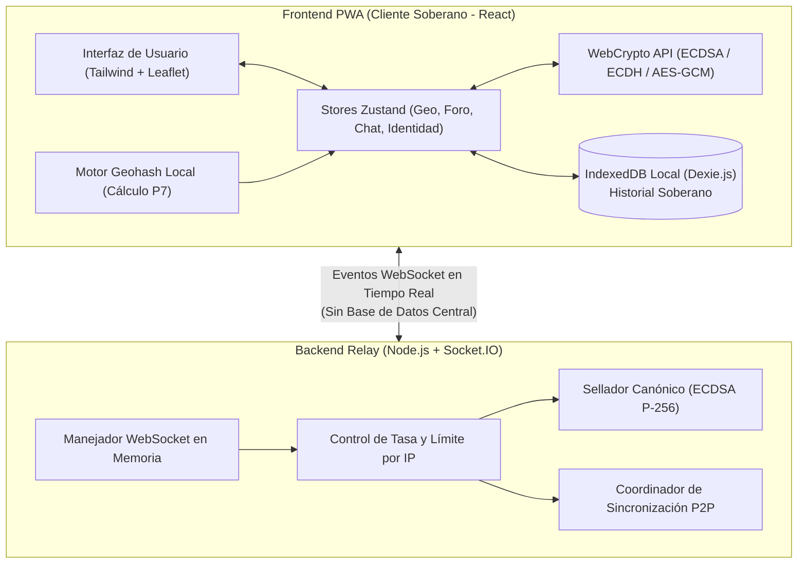
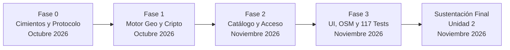

# 🎤 INFORME DE PRESENTACIÓN DEL PROYECTO: ZONAVIVA
## Estructura Integral de las 5 Preguntas Clave
### Asignatura: Lenguajes de Programación — Unidad 2 (Ciclo VII)

---

| Ficha del Proyecto | Detalle |
| :--- | :--- |
| **Nombre del Proyecto** | **ZonaViva — Red Social Geográfica Descentralizada** |
| **Tipo de Producto** | Aplicación Web Progresiva (PWA) + Relay WebSocket en Memoria |
| **Zona Piloto** | Ciudad de Puno, Perú (6 Zonas Oficiales OpenStreetMap) |
| **Marco Académico** | Unidad 2: Lenguajes de Programación (Paradigmas, Tipado, Concurrencia y Criptografía) |
| **Estado del Software** | ✅ 100% Funcional · 117 Pruebas Unitarias Pasando · 0 Errores de Tipado |
| **Fecha de Sustentación** | Noviembre de 2026 |

---

## 📑 Índice de la Presentación

1. [Pregunta 1: ¿QUÉ? — El Objetivo y Contenido](#1-pregunta-1-qué--el-objetivo-y-contenido)
   - 1.1 ¿Qué es ZonaViva?
   - 1.2 Objetivo General y Objetivos Específicos
   - 1.3 Contenido Técnico y Módulos del Producto
   - 1.4 Entregables Tangibles del Software
2. [Pregunta 2: ¿POR QUÉ Y PARA QUÉ? — La Justificación y el Impacto](#2-pregunta-2-por-qué-y-para-qué--la-justificación-y-el-impacto)
   - 2.1 ¿Por qué nace el proyecto? (Diagnóstico de la Problemática)
   - 2.2 ¿Para qué se construye? (Propuesta de Valor e Innovación)
   - 2.3 Impacto Social, Comunitario y Académico
3. [Pregunta 3: ¿CÓMO? — La Metodología y Estrategia](#3-pregunta-3-cómo--la-metodología-y-estrategia)
   - 3.1 Metodología de Desarrollo de Software (Scrum Iterativo y TDD)
   - 3.2 Estrategia Arquitectónica (Monorepo y Relay Cero-Persistencia)
   - 3.3 Estrategia de Criptografía y Seguridad (Sellado Canónico y E2EE)
   - 3.4 Estrategia Geoespacial y Algorítmica (Geohash P7 y Topología BFS OSM)
   - 3.5 Estrategia Offline-First (IndexedDB y Service Workers)
   - 3.6 Aseguramiento de Calidad y Pruebas Automatizadas
4. [Pregunta 4: ¿QUIÉNES? — Los Responsables y Beneficiarios](#4-pregunta-4-quiénes--los-responsables-y-beneficiarios)
   - 4.1 Responsables del Proyecto (Equipo de Desarrollo y Roles)
   - 4.2 Beneficiarios Directos (Comunidad de Puno)
   - 4.3 Beneficiarios Indirectos
5. [Pregunta 5: ¿DÓNDE Y CUÁNDO? — El Espacio y el Tiempo](#5-pregunta-5-dónde-y-cuándo--el-espacio-y-el-tiempo)
   - 5.1 ¿Dónde? — El Ámbito Espacial y Físico (Piloto Puno)
   - 5.2 ¿Dónde? — El Entorno Tecnológico y Plataforma Digital
   - 5.3 ¿Cuándo? — El Cronograma, Fases de Desarrollo e Hitos
   - 5.4 Hoja de Ruta Post-MVP
6. [Resumen Ejecutivo para la Exposición Oral (Pitch de 3 Minutos)](#6-resumen-ejecutivo-para-la-exposición-oral-pitch-de-3-minutos)

---

## 1. Pregunta 1: ¿QUÉ? — El Objetivo y Contenido

```
┌────────────────────────────────────────────────────────────────────────┐
│                               ¿QUÉ?                                    │
│   Una Red Social Web Hiperlocal, Descentralizada y Privada (PWA)       │
│    donde la ubicación física define los espacios de conversación       │
│            sin intermediación de bases de datos centrales              │
└────────────────────────────────────────────────────────────────────────┘
```

### 1.1 ¿Qué es ZonaViva?
**ZonaViva** es una plataforma de interacción social hiperlocal construida como Aplicación Web Progresiva (PWA). Permite a las personas conversar en foros y chats en tiempo real condicionados a su **ubicación física real**, con una premisa revolucionaria: **el servidor no almacena mensajes ni base de datos alguna, y las coordenadas GPS exactas nunca salen del dispositivo del usuario**.

### 1.2 Objetivo General y Objetivos Específicos

#### Objetivo General
Desarrollar y evaluar una plataforma de red social geográfica descentralizada basada en foros hiperlocales y mensajería en tiempo real, garantizando la soberanía de los datos del usuario mediante almacenamiento local (`IndexedDB`), privacidad por diseño y un servidor de retransmisión (*relay*) efímero en memoria.

#### Objetivos Específicos
1. **Construir un Relay WebSocket Cero-Persistencia:** Desarrollar en Node.js y Socket.IO un intermediario liviano que enrute eventos, asigne marcas de tiempo monotónicas oficiales (`relayTs`) y selle canónicamente los mensajes con firmas digitales **ECDSA P-256** sin guardar nada en disco.
2. **Implementar Geofencing Seguro en el Cliente:** Crear una librería matemática de cálculo geodésico basada en **Geohashes de precisión 7 (~153 m)** que determine si el usuario está físicamente dentro de una zona sin transmitir latitud ni longitud a la red.
3. **Delimitar Topológicamente la Zona Piloto (Puno):** Extraer geometrías vectoriales de OpenStreetMap para 6 nodos estratégicos de Puno, asegurando matemáticamente **Cero Solapamiento** entre zonas y **Cero Islas** (100% de conexidad mediante algoritmos de grafos BFS).
4. **Implementar Cifrado Extremo a Extremo (E2EE):** Proveer chats aleatorios 1 a 1 y mensajería directa entre pares utilizando el estándar nativo **WebCrypto API (ECDH P-256 + HKDF + AES-GCM-256)** con verificación visual antisuplantación (SAS).
5. **Garantizar Persistencia y Sincronización Soberana:** Dotar a la aplicación web de una base de datos local (`IndexedDB` vía Dexie.js) con soporte para bandeja de salida offline y sincronización histórica P2P entre usuarios conectados.

### 1.3 Contenido Técnico y Módulos del Producto

El software está compuesto por los siguientes módulos integrados:

```
┌────────────────────────────────────────────────────────────────────────┐
│                        MÓDULOS DE ZONAVIVA                             │
├───────────────────┬────────────────────────────────────────────────────┤
│ 🗺️ Mapa y Geo     │ Leaflet + OSM, radar GPS reactivo, cálculo Geohash │
├───────────────────┼────────────────────────────────────────────────────┤
│ 🏛️ Foros de Zona   │ Foros permanentes en las 6 zonas de Puno           │
├───────────────────┼────────────────────────────────────────────────────┤
│ 📍 Foros Usuario  │ Foros efímeros barriales (radio 50m a 1000m, 24h)  │
├───────────────────┼────────────────────────────────────────────────────┤
│ ✨ Chat Aleatorio │ 1 a 1 efímero con cifrado E2EE y código SAS        │
├───────────────────┼────────────────────────────────────────────────────┤
│ 👥 Chats Directos │ Contactos permanentes y solicitudes de pares       │
├───────────────────┼────────────────────────────────────────────────────┤
│ 🛡️ Criptografía   │ WebCrypto nativo: ECDSA (firmas) y ECDH (canales)  │
├───────────────────┼────────────────────────────────────────────────────┤
│ 💾 Offline / PWA  │ IndexedDB soberano, Service Worker y Outbox local  │
└───────────────────┴────────────────────────────────────────────────────┘
```

- **Módulo de Mapa Interactivo (`ZoneMap`, `ZonesLayer`, `UserPositionLayer`):** Visualización cartográfica de Puno, dibujo de polígonos con colores temáticos por zona, visualizador del radar de precisión GPS y control de auto-seguimiento.
- **Módulo de Foros Geográficos Permanentes (`ForoPage`):** Salas públicas asociadas a hitos cívicos y comerciales de Puno. Permite lectura libre desde cualquier lugar ("Modo Exploración") y condiciona la publicación a estar físicamente en la zona ("Modo Presencial").
- **Módulo de Foros Comunitarios Temporales (`CrearForoPage`, `UserForumsLayer`):** Permite a cualquier ciudadano en campo fundar un foro efímero en su celda Geohash, seleccionando un radio de cobertura (50m a 1000m). Cuenta con regla de extinción automática tras 24 horas sin participantes activos ($N=0$).
- **Módulo de Chat Aleatorio 1 a 1 (`ChatPage`):** Emparejamiento hiperlocal espontáneo cifrado de extremo a extremo sin almacenamiento en servidor.
- **Módulo de Mensajería Directa entre Pares (`directChatStore`, `DirectConversationView`):** Permite entablar amistad y conservar canales privados cifrados con autores conocidos en los foros.
- **Módulo de Identidad y Ajustes (`AjustesPage`):** Gestión de alias temporal, regeneración de llaves criptográficas y control soberano de los datos locales (limpieza selectiva o purga total).

### 1.4 Entregables Tangibles del Software
1. **Monorepo Funcional:** Arquitectura modular con `pnpm workspaces` conteniendo `@zonaviva/protocol`, `@zonaviva/web` y `@zonaviva/relay`.
2. **Aplicación Web Progresiva (PWA):** Compilada para producción con soporte para instalación en Android, iOS y computadoras de escritorio.
3. **Servidor Relay en Memoria:** Servicio en Node.js y Socket.IO con sellado canónico y coordinación P2P.
4. **Batería de Calidad:** 117 pruebas automatizadas unitarias e integradas con Vitest ejecutadas con 100% de éxito.

---

## 2. Pregunta 2: ¿POR QUÉ Y PARA QUÉ? — La Justificación y el Impacto

```
┌────────────────────────────────────────────────────────────────────────┐
│                         ¿POR QUÉ Y PARA QUÉ?                           │
│     POR QUÉ: Las redes actuales espían, centralizan y aíslan           │
│     PARA QUÉ: Recuperar la plaza pública local con privacidad total    │
└────────────────────────────────────────────────────────────────────────┘
```

### 2.1 ¿Por qué nace el proyecto? (Diagnóstico de la Problemática)

Las redes sociales comerciales (Facebook, Twitter/X, Instagram, WhatsApp) presentan fallas estructurales graves:

1. **Vigilancia y Comercialización de Datos:** Exigen identificadores reales (números telefónicos, nombres, correos electrónicos) y recopilan historiales continuos de ubicación GPS para construir perfiles de rastreo publicitario.
2. **Desconexión del Espacio Físico Local:** Sus algoritmos priorizan contenidos globales polarizantes y cámaras de eco de afinidad ideológica, desatendiendo la realidad inmediata: ¿qué está pasando en este momento en el mercado?, ¿hay congestión en el centro?, ¿qué evento cultural se desarrolla en la plaza?
3. **Riesgos de la Centralización:** El almacenamiento centralizado de mensajes e historiales en gigantescos centros de datos corporativos expone a la sociedad a filtraciones masivas de datos, ataques cibernéticos y censura unilateral.

### 2.2 ¿Para qué se construye? (Propuesta de Valor e Innovación)

ZonaViva se construye para proporcionar una **alternativa soberana, hiperlocal y respetuosa**:

- **Para conectar a las personas con su comunidad inmediata:** Habilitar un canal digital espontáneo para los ciudadanos que coexisten en el mismo espacio geográfico.
- **Para hacer realidad la "Privacidad por Diseño":** 
  - La posición GPS es procesada exclusivamente en la CPU del navegador.
  - Al servidor relay solo se envían códigos de zona o celdas Geohash aproximadas, imposibilitando la triangulación o el rastreo de trayectorias individuales.
  - El relay no mantiene base de datos; la memoria es efímera.
- **Para devolver la soberanía a los usuarios:** El contenido de las conversaciones reside en la memoria de los propios dispositivos (`IndexedDB`). Si el servidor se apaga o reinicia, la historia no se pierde porque vive en los participantes.

### 2.3 Impacto Social, Comunitario y Académico

#### Impacto en la Comunidad de Puno
- **Dinamización del Comercio Tradicional:** En el Mercado Central, Mercado Bellavista y Mercado Unión y Dignidad, los comerciantes y compradores pueden publicar avisos instantáneos de precios, productos frescos del día o congestión peatonal.
- **Coordinación Universitaria en la UNAP:** Espacio libre para debates estudiantiles, anuncios académicos, ferias de libros y organización de actividades sin requerir redes corporativas ni registro de datos personales.
- **Participación Cívica en Plazas:** En la Plaza Mayor y Parque Pino, los ciudadanos pueden reportar incidencias en vivo, actividades culturales o alertas comunitarias en tiempo real.

#### Impacto en la Asignatura de Lenguajes de Programación
- Demuestra el dominio de los paradigmas contemporáneos del desarrollo de software:
  - **Programación Reactiva y Funcional:** Hooks inmutables en React 18 y gestión de estado predecible en Zustand.
  - **Tipado Estático Riguroso:** Modelado formal de tipos y contratos en TypeScript 5.x (`tsc --noEmit`), garantizando cero fallos de tipo en tiempo de ejecución.
  - **Validación en Tiempo de Ejecución:** Esquemas formales con Zod que blindan al sistema contra payloads malformados o ataques por inyección.
  - **Criptografía de Alto Nivel:** Implementación directa del estándar WebCrypto API (curvas elípticas P-256) sin delegar en librerías externas de terceros.

---

## 3. Pregunta 3: ¿CÓMO? — La Metodología y Estrategia

```
┌────────────────────────────────────────────────────────────────────────┐
│                                 ¿CÓMO?                                 │
│   Metodología Ágil (Scrum) + TDD + Arquitectura Monorepo Modular       │
│        + Relay Cero-DB + Criptografía WebCrypto + Topología OSM        │
└────────────────────────────────────────────────────────────────────────┘
```

### 3.1 Metodología de Desarrollo de Software
El proyecto se ejecutó bajo una metodología ágil iterativa basada en **Scrum** y **Desarrollo Guiado por Pruebas (TDD)**:
- **Iteraciones Cortas y Entregables Funcionales:** Cada fase del proyecto concluyó con software operativo, probado y documentado.
- **Batería de Pruebas Unitarias Continuas:** Creación de suites de prueba con Vitest previas o simultáneas a la implementación de los servicios de geocálculo, criptografía y sincronización.

### 3.2 Estrategia Arquitectónica (Monorepo y Relay Cero-Persistencia)



- **Patrón Monorepo (`pnpm workspaces`):**
  - `packages/protocol`: Biblioteca pura con tipos TypeScript, contratos Zod y catálogo topológico compartido entre cliente y servidor.
  - `apps/web`: Aplicación de interfaz de usuario PWA en React 18, Vite y Tailwind CSS.
  - `apps/relay`: Servidor de enrutamiento WebSocket en Node.js sin bases de datos tradicionales (ni PostgreSQL, ni MongoDB).
- **Separación Radical de Responsabilidades:** El relay se limita al transporte de paquetes y al sellado; la inteligencia espacial, la retención de mensajes y la seguridad residen en los clientes.

### 3.3 Estrategia de Criptografía y Seguridad

```
           ┌──────────────────────────────────────────────┐
           │        ESTRATEGIA CRIPTOGRÁFICA              │
           └──────────────────────────────────────────────┘
                                  │
         ┌────────────────────────┴────────────────────────┐
         ▼                                                 ▼
┌──────────────────────────────┐        ┌──────────────────────────────┐
│  SELLADO CANÓNICO DEL RELAY  │        │   CIFRADO E2EE EN CHATS      │
├──────────────────────────────┤        ├──────────────────────────────┤
│ • Marca oficial 'relayTs'    │        │ • Acuerdo de claves ECDH     │
│ • Hash SHA-256 de contenido  │        │ • Derivación HKDF-SHA256     │
│ • Firma ECDSA P-256          │        │ • Cifrado AES-GCM-256        │
│ • Previene manipulación P2P  │        │ • Código SAS de 6 dígitos    │
└──────────────────────────────┘        └──────────────────────────────┘
```

1. **Sellado Canónico Oficial:** El relay recibe cada mensaje de foro, le asigna una marca de tiempo monotónica estricta (`relayTs`) y firma la tupla `(id, forumId, relayTs, sha256(content))` con su par ECDSA P-256. Esto evita que réplicas maliciosas falsifiquen mensajes históricos durante la sincronización P2P.
2. **Canales Privados Cifrados Extremo a Extremo:** En los chats 1 a 1 y mensajes directos, los navegadores generan pares de claves efímeras ECDH P-256, derivan una clave simétrica con HKDF y cifran los textos con **AES-GCM-256**. El servidor relay solo ve texto cifrado (*ciphertext*) ininteligible.
3. **Código de Autenticación Visual (SAS):** Se extrae un código de 6 dígitos del secreto compartido. Si ambos participantes leen el mismo número en pantalla, se descarta cualquier ataque Man-in-the-Middle (MitM).

### 3.4 Estrategia Geoespacial y Algorítmica (Puno, Perú)
1. **Indexación Geohash Precisión 7:** Malla espacial que divide el territorio en cuadrantes regulares de aproximadamente 153 metros. Permite realizar consultas espaciales en tiempo constante $O(1)$.
2. **Delimitación Vectorial con OpenStreetMap (OSM):** Extracción de geometrías GeoJSON reales de Puno mediante consultas a la API de Overpass/Nominatim.
3. **Validación Topológica Automatizada (`validateZones.ts`):**
   - **Cero Solapamiento:** Las 50 celdas Geohash asignadas son disjuntas; ninguna celda pertenece a dos zonas a la vez.
   - **Cero Islas:** Algoritmo de búsqueda en anchura (**BFS / Flood-Fill**) sobre la matriz de 8 vecinos geodésicos para garantizar que cada zona constituya un único polígono continuo.

### 3.5 Estrategia Offline-First (PWA y Dexie.js)
- **Service Worker con Workbox:** Precaché integral de recursos (HTML, JS, CSS, iconos, mapas base) para permitir el arranque de la aplicación sin conexión a internet.
- **Bandeja de Salida (`Outbox`):** Si el usuario emite un mensaje mientras cruza una zona sin cobertura celular, el mensaje se retiene en cola local en `IndexedDB`. Al dispararse el evento `window.online`, el sistema lo despacha automáticamente al relay para su sellado oficial.

### 3.6 Aseguramiento de Calidad y Pruebas Automatizadas
- **117 pruebas automatizadas** ejecutadas con Vitest en 13 suites de prueba (100% pasadas, 0 fallos).
- **Tipado TypeScript estricto:** 0 errores en compilación estática (`pnpm typecheck`).
- **Build de producción exitoso:** Optimización de paquetes con división de código (`manualChunks`) y manifiesto PWA generado.

---

## 4. Pregunta 4: ¿QUIÉNES? — Los Responsables y Beneficiarios

```
┌────────────────────────────────────────────────────────────────────────┐
│                              ¿QUIÉNES?                                 │
│      RESPONSABLES: Estudiantes de Lenguajes de Programación            │
│      BENEFICIARIOS: Ciudadanos, Estudiantes y Comerciantes de Puno     │
└────────────────────────────────────────────────────────────────────────┘
```

### 4.1 Responsables del Proyecto (Equipo de Desarrollo y Roles)

El proyecto ha sido concebido, estructurado y desarrollado íntegramente por los estudiantes del curso de **Lenguajes de Programación (Ciclo VII)**:

| Rol Asumido en el Proyecto | Responsabilidades Principales | Tecnologías Dominadas |
| :--- | :--- | :--- |
| **Arquitecto de Software** | Diseño del monorepo, contratos de comunicación, esquemas de dominio y ADRs. | Monorepos, pnpm, Zod, Git |
| **Desarrollador Frontend & UX** | Diseño de vistas responsivas PWA, mapas en Leaflet, componentes reactivos y Tailwind. | React 18, Leaflet, Tailwind CSS |
| **Ingeniero de Protocolo y Relay** | Servidor WebSocket efímero, asignación de `relayTs`, sellado canónico y salas. | Node.js, Socket.IO, TypeScript |
| **Ingeniero de Criptografía y Seguridad** | Canales E2EE, intercambio de claves ECDH, firmas ECDSA y derivación HKDF. | WebCrypto API, IEEE P1363, AES-GCM |
| **Ingeniero Geoespacial y Algoritmos** | Modelado Geohash, extracción OSM, matrices de vecinos y validador topológico BFS. | Geohash, OpenStreetMap, BFS |
| **Ingeniero de QA y Persistencia** | Batería de 117 tests con Vitest, repositorios Dexie/IndexedDB y outbox offline. | Vitest, Dexie.js, IndexedDB |

### 4.2 Beneficiarios Directos (Comunidad de Puno)

El software beneficia directamente a tres núcleos sociales estratégicos de la ciudad:

```
                          ┌───────────────────────────┐
                          │   BENEFICIARIOS DIRECTOS  │
                          └─────────────┬─────────────┘
                                        │
         ┌──────────────────────────────┼──────────────────────────────┐
         ▼                              ▼                              ▼
┌──────────────────┐           ┌──────────────────┐           ┌──────────────────┐
│   COMERCIANTES   │           │   UNIVERSITARIOS │           │   CIUDADANOS Y   │
│   Y CLIENTES     │           │    DE LA UNAP    │           │    TRANSEÚNTES   │
├──────────────────┤           ├──────────────────┤           ├──────────────────┤
│ • Mercado Central│           │ • 26 celdas del  │           │ • Plaza Mayor    │
│ • Unión y Dign.  │           │   campus central │           │ • Parque Pino    │
│ • M. Bellavista  │           │ • Avisos de clases│           │ • Alertas viales │
│ • Precios del día│           │ • Ferias y libros│           │ • Eventos en vivo│
│ • Stock fresco   │           │ • Debates libres │           │ • Cultura local  │
└──────────────────┘           └──────────────────┘           └──────────────────┘
```

1. **Comerciantes y Población Consumidora (Sector Abastecimiento):**
   - Comerciantes de los mercados **Central**, **Unión y Dignidad** y **Bellavista**.
   - Beneficio: Compartir el precio del día de verduras, carnes y abarrotes, llegada de camiones con mercadería o alertas de seguridad sin costo publicitario ni comisiones.
2. **Comunidad Universitaria (Sector Académico - UNAP):**
   - Más de 20,000 estudiantes, docentes y trabajadores del Campus Universitario de la Universidad Nacional del Altiplano.
   - Beneficio: Foros espontáneos para consultar sobre trámites, avisos de suspensión de clases, actividades de facultades, grupos de estudio o ferias gastronómicas.
3. **Vecinos y Transeúntes Cívicos (Sector Ciudadano):**
   - Transeúntes de la **Plaza Mayor** y del **Parque Pino**.
   - Beneficio: Difusión de actividades culturales, festividades patronales (como la Virgen de la Candelaria), estado del transporte público y alertas de emergencia ciudadana.

### 4.3 Beneficiarios Indirectos
- **Defensores de los Derechos Digitales y la Privacidad:** Colectivos que promueven herramientas libres que no mercantilizan la información personal.
- **Comunidad Universitaria y de Desarrolladores:** Estudiantes y docentes del área de ingeniería de sistemas e informática, quienes disponen de una base de código de referencia con buenas prácticas de arquitectura modular, criptografía moderna y cobertura completa de pruebas.

---

## 5. Pregunta 5: ¿DÓNDE Y CUÁNDO? — El Espacio y el Tiempo

```
┌────────────────────────────────────────────────────────────────────────┐
│                            ¿DÓNDE Y CUÁNDO?                            │
│         DÓNDE: Ciudad de Puno, Perú + Navegadores Web PWA              │
│         CUÁNDO: Desarrollado en 2026 en 4 Fases con Éxito Total        │
└────────────────────────────────────────────────────────────────────────┘
```

### 5.1 ¿Dónde? — El Ámbito Espacial y Físico (Piloto Puno)
El proyecto está físicamente anclado en la ciudad de **Puno, departamento de Puno, Perú**, situada en la meseta del Collao a orillas del Lago Titicaca (3,827 metros sobre el nivel del mar).

- **Bounding Box Geodésico del Piloto:**
  - Latitud: entre `-15.8600` y `-15.8150` Sur.
  - Longitud: entre `-70.0400` y `-70.0050` Oeste.

```
┌─────────────────────────────────────────────────────────────────────────────────┐
│                    ZONAS PILOTO DELIMITADAS EN PUNO (OSM)                       │
├─────────────────────┬───────────────────┬──────────────┬──────────────┬─────────┤
│ Identificador ID    │ Nombre Visible    │ Tipo OSM     │ Geohashes P7 │ Tono    │
├─────────────────────┼───────────────────┼──────────────┼──────────────┼─────────┤
│ mercado-central     │ Mercado Central   │ marketplace  │ 4 celdas     │ Naranja │
│ mercado-union       │ Mercado Unión     │ marketplace  │ 6 celdas     │ Rosa    │
│ mercado-bellavista  │ M. Bellavista     │ marketplace  │ 6 celdas     │ Amarillo│
│ plaza-mayor         │ Plaza Mayor       │ square       │ 4 celdas     │ Violeta │
│ parque-pino         │ Parque Pino       │ park         │ 4 celdas     │ Verde   │
│ unap-campus         │ Campus UNAP       │ university   │ 26 celdas    │ Azul    │
└─────────────────────┴───────────────────┴──────────────┴──────────────┴─────────┘
```

### 5.2 ¿Dónde? — El Entorno Tecnológico y Plataforma Digital
- **Dispositivos Compatibles:** Smartphones Android, iPhones/iPads (iOS), computadoras de escritorio (Windows, Linux, macOS).
- **Entorno de Ejecución:** Navegadores modernos con soporte de estándares W3C (Chrome, Edge, Firefox, Safari).
- **Infraestructura de Red:** Funciona tanto en redes locales (intranet universitaria / WiFi comunitario) como en internet abierta mediante un relay WebSocket seguro (`wss://`).

### 5.3 ¿Cuándo? — El Cronograma, Fases de Desarrollo e Hitos

El proyecto se estructuró a lo largo de **4 Fases Consecutivas** durante el semestre académico 2026:



| Fase / Hito | Periodo | Objetivos y Logros Alcanzados | Estado |
| :--- | :---: | :--- | :---: |
| **Fase 0: Cimientos y Protocolo** | Oct 2026 | Definición de contratos TypeScript, esquemas de validación Zod y arquitectura monorepo `pnpm`. | ✅ Completada |
| **Fase 1: Motor Geoespacial y Criptografía** | Oct 2026 | Librería pura de Geohash, distancia Haversine y generación de identidades WebCrypto. | ✅ Completada |
| **Fase 2: Catálogo de Zonas y Control de Acceso** | Nov 2026 | Catálogo estructurado de Puno, `accessPolicy` (frescura < 60s, precisión $\le$ 300m) y Zustand stores. | ✅ Completada |
| **Fase 3: Mapas Leaflet, Topología OSM y Calidad** | Nov 2026 | Extracción de geometrías OSM, validación BFS (cero islas), capas UI y **117 tests pasando**. | ✅ Completada |
| **Hito Actual: Presentación de Unidad 2** | Nov 2026 | Sustentación técnica formal ante la cátedra de Lenguajes de Programación. | 🎯 En Curso |

### 5.4 Hoja de Ruta Post-MVP
- **Nodos Archivistas Comunitarios (Q1 2027):** Servidores voluntarios de solo lectura para preservar la historia de zonas con poca actividad en horas de la madrugada.
- **Soporte Multimedia Liviano Descentralizado (Q2 2027):** Compartición de fotografías optimizadas mediante canales de datos WebRTC o direccionamiento por contenido (IPFS).
- **Expansión a Nuevas Ciudades (Q3 2027):** Pipeline automatizado para cargar zonas de Juliaca, Arequipa y Cusco mediante configuración declarativa de OpenStreetMap.

---

## 6. Resumen Ejecutivo para la Exposición Oral (Pitch de 3 Minutos)

> **Guión Sugerido para el Alumno durante la Exposición:**

1. **¿Qué es? (30 segundos):**  
   *"Buenos días profesor y compañeros. Hoy les presentamos **ZonaViva**, una red social geográfica basada en la web que permite a las personas comunicarse en foros y chats en tiempo real asociados a lugares físicos reales. Su gran innovación es que funciona sin bases de datos centrales y respeta al 100% la privacidad del usuario: las coordenadas GPS exactas jamás salen del teléfono."*

2. **¿Por qué y para qué? (45 segundos):**  
   *"¿Por qué lo hicimos? Porque las redes como Meta o X nos espían, exigen nuestros números de teléfono y nos aíslan de lo que pasa en nuestra propia calle. ZonaViva se construyó **para recuperar la plaza pública digital**: para que los comerciantes y compradores del Mercado Central, o los estudiantes de la UNAP, puedan saber al instante qué está sucediendo a su alrededor con total anonimato y sin registro de datos personales."*

3. **¿Cómo funciona? (60 segundos):**  
   *"¿Cómo lo logramos técnicamente? Aplicamos una arquitectura moderna tipo monorepo en TypeScript. En el cliente usamos React 18, Leaflet y WebCrypto nativo para cifrar las conversaciones de extremo a extremo. El servidor relay en Node.js es efímero: no guarda mensajes en disco, solo los retransmite y los sella criptográficamente con firmas ECDSA para garantizar que nadie altere la historia. Todo el historial se almacena soberanamente en el navegador de cada usuario con IndexedDB. Además, delimitamos 6 zonas oficiales en Puno extrayendo polígonos de OpenStreetMap y verificamos matemáticamente con algoritmos de grafos (BFS) que no existan islas ni solapamientos. Todo el sistema cuenta con 117 pruebas automatizadas que pasan con 100% de éxito."*

4. **¿Quiénes, dónde y cuándo? (45 segundos):**  
   *"¿Quiénes somos? Somos estudiantes del curso de Lenguajes de Programación y hemos asumido roles de arquitectura, seguridad y desarrollo espacial. ¿Dónde? El piloto funciona en Puno, cubriendo el Mercado Central, Mercado Unión, Bellavista, Plaza Mayor, Parque Pino y la UNAP. ¿Cuándo? Hemos completado 4 fases continuas de desarrollo y hoy presentamos el MVP en pleno funcionamiento y listo para su uso."*

---

*Documento formal de sustentación elaborado para la cátedra de Lenguajes de Programación — Noviembre 2026.*
