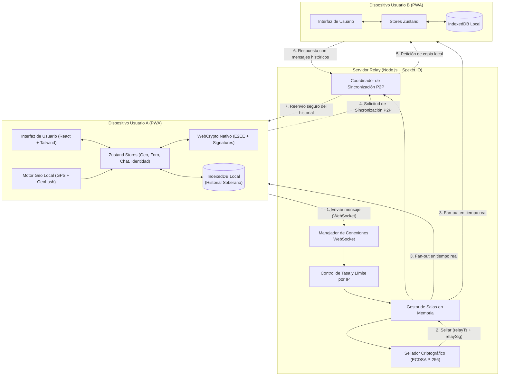
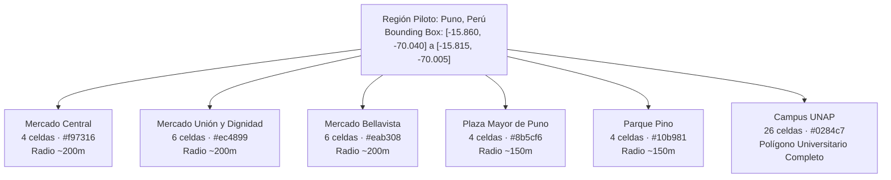
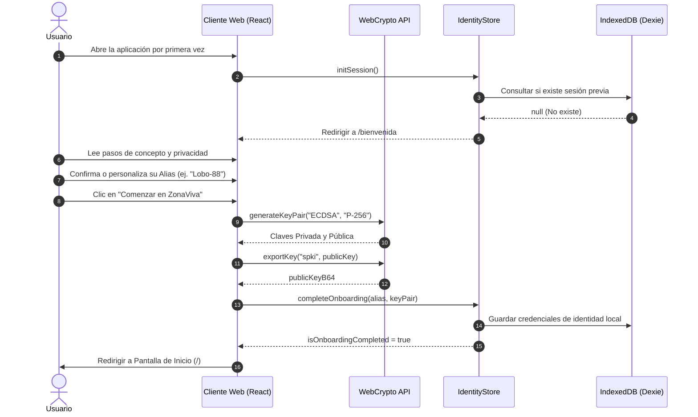
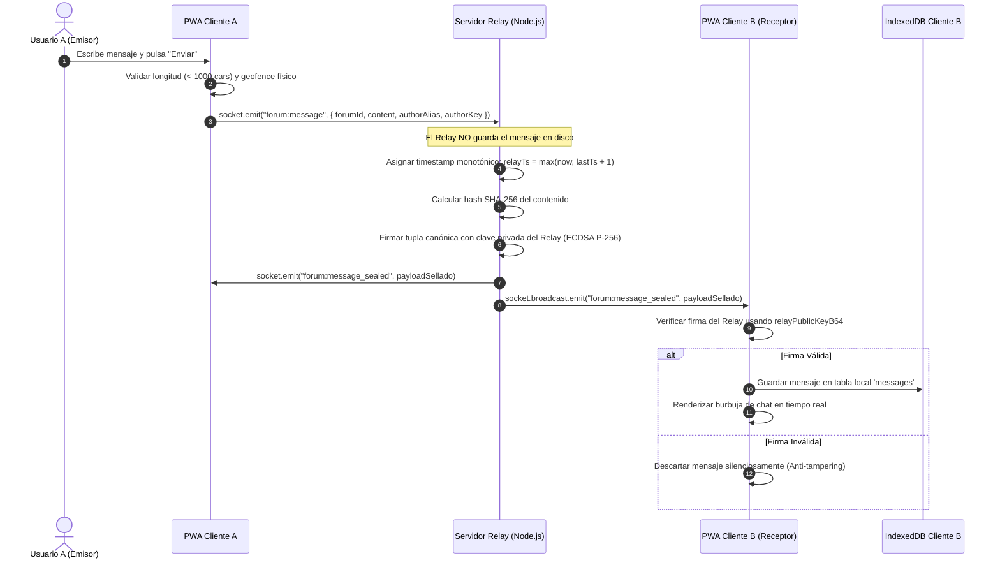
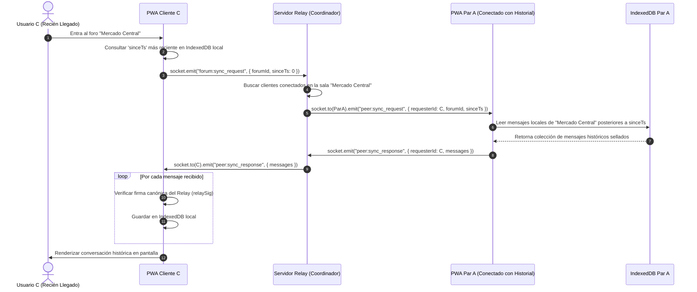
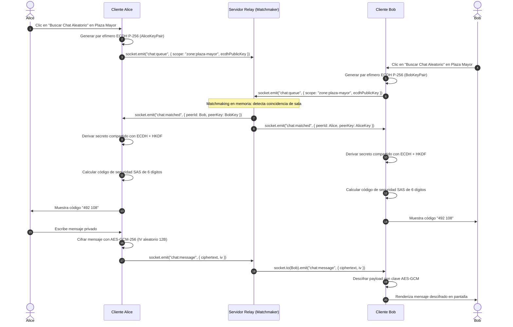
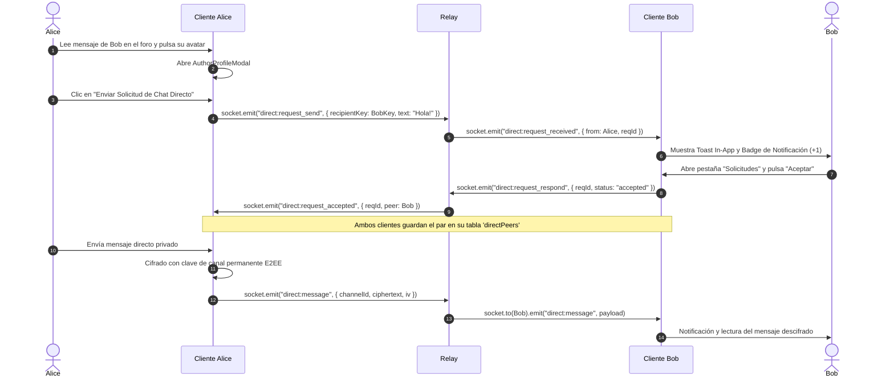
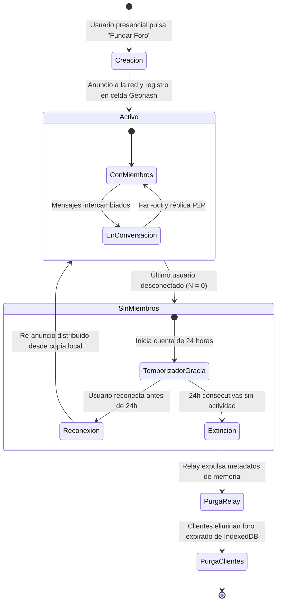
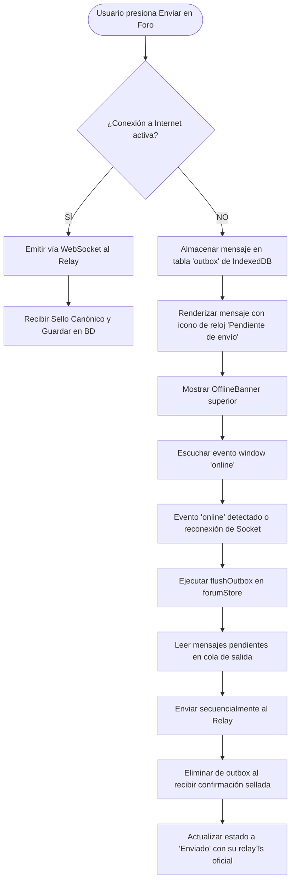

# 🌐 ZonaViva — Red Social Geográfica Descentralizada
## Informe Integral de Presentación del Proyecto
### Asignatura: Lenguajes de Programación — Unidad 2 (Proyecto Semestral)

---

| Metadato | Detalle |
| :--- | :--- |
| **Proyecto** | **ZonaViva (MVP v3.1)** |
| **Tipo de Aplicación** | Aplicación Web Progresiva (PWA) + Servidor Relay en Memoria |
| **Zona Piloto** | Ciudad de Puno, Perú (6 Zonas Oficiales OpenStreetMap) |
| **Arquitectura** | Monorepo Descentralizado (Client-Heavy, Zero-Database Relay, P2P Sync) |
| **Seguridad** | Cifrado E2EE (ECDH P-256 + AES-GCM-256), Sellado Canónico ECDSA P-256 |
| **Estado del Software** | ✅ 100% Operativo · 117 Pruebas Unitarias Pasando · Tipado Estricto TypeScript |
| **Fecha de Presentación** | Noviembre de 2026 |

---

## 📑 Tabla de Contenidos

1. [Resumen Ejecutivo](#1-resumen-ejecutivo)
2. [Planteamiento del Problema y Justificación](#2-planteamiento-del-problema-y-justificación)
3. [Objetivos del Proyecto](#3-objetivos-del-proyecto)
   - 3.1 Objetivo General
   - 3.2 Objetivos Específicos
4. [Filosofía y Principios de Diseño](#4-filosofía-y-principios-de-diseño)
5. [Arquitectura del Sistema y Monorepo](#5-arquitectura-del-sistema-y-monorepo)
   - 5.1 Estructura del Espacio de Trabajo (`pnpm workspaces`)
   - 5.2 Diagrama Arquitectónico Integral
   - 5.3 Rol del Relay Cero-Persistencia vs. Clientes Soberanos
   - 5.4 Justificación de las Decisiones de Arquitectura Web y Diseño Frontend (UI/UX)
6. [Protocolo de Comunicación y Seguridad Criptográfica](#6-protocolo-de-comunicación-y-seguridad-criptográfica)
   - 6.1 Sellado Canónico y Timestamping (`relayTs` y `relaySig`)
   - 6.2 Cifrado Extremo a Extremo (E2EE) en Chats Privados
   - 6.3 Protocolo de Sincronización Distribuida P2P
7. [Motor de Geolocalización y Modelo Topológico (Puno, Perú)](#7-motor-de-geolocalización-y-modelo-topológico-puno-perú)
   - 7.1 Geohashing como Mecanismo de Privacidad
   - 7.2 Delimitación Topológica desde OpenStreetMap (OSM)
   - 7.3 Reglas Topológicas: Cero Solapamiento y Cero Islas
   - 7.4 Matriz de Control de Acceso Geográfico
8. [Catálogo Completo de Vistas de la Aplicación (UI/UX)](#8-catálogo-completo-de-vistas-de-la-aplicación-uiux)
   - 8.1 Vista de Bienvenida y Onboarding (`/bienvenida`)
   - 8.2 Vista de Inicio y Mapa Interactivo (`/`)
   - 8.3 Vista de Directorio de Foros (`/foros`)
   - 8.4 Vista de Sala de Foro en Tiempo Real (`/foro/:id`)
   - 8.5 Vista de Creación de Foro Temporal de Usuario (`/foros/nuevo`)
   - 8.6 Vista de Centro de Mensajería y Chats E2EE (`/chat`)
   - 8.7 Vista de Ajustes, Privacidad y Persistencia Soberana (`/ajustes`)
   - 8.8 Modales y Subcomponentes Críticos de Interacción
9. [Flujos de Usuario y de Sistema](#9-flujos-de-usuario-y-de-sistema)
   - 9.1 Flujo de Onboarding y Generación Criptográfica
   - 9.2 Flujo de Geocercado y Control de Acceso a Publicación
   - 9.3 Flujo de Publicación y Sellado Canónico de Mensajes
   - 9.4 Flujo de Sincronización P2P Asistida por Relay
   - 9.5 Flujo de Chat Aleatorio 1 a 1 Cifrado E2EE
   - 9.6 Flujo de Mensajería Directa entre Pares
   - 9.7 Flujo de Ciclo de Vida y Extinción de Foros de Usuario
   - 9.8 Flujo Offline y Despacho Automático de Bandeja de Salida
10. [Lista Exhaustiva de Funcionalidades del Sistema](#10-lista-exhaustiva-de-funcionalidades-del-sistema)
11. [Aseguramiento de la Calidad y Pruebas de Software](#11-aseguramiento-de-la-calidad-y-pruebas-de-software)
    - 11.1 Matriz de Pruebas Automatizadas (117 Tests)
    - 11.2 Verificación de Tipado Estricto y Construcción
12. [Guía de Despliegue y Ejecución](#12-guía-de-despliegue-y-ejecución)
    - 12.1 Requisitos del Sistema
    - 12.2 Instalación de Dependencias
    - 12.3 Ejecución en Entorno de Desarrollo
    - 12.4 Verificación de Calidad y Tests
    - 12.5 Pruebas en Dispositivos Móviles Reales: Contexto Seguro (HTTPS) y Túnel Cloudflare
13. [Conclusiones y Trabajo Futuro](#13-conclusiones-y-trabajo-futuro)

---

## 1. Resumen Ejecutivo

**ZonaViva** es una plataforma de red social hiperlocal y descentralizada construida sobre el estándar de Aplicación Web Progresiva (PWA). El propósito central es devolver las interacciones digitales a su contexto espacial físico inmediato: permitir que los ciudadanos conversen, debatan y colaboren en tiempo real dentro de espacios compartidos (plazas, mercados, campus universitarios, barrios) con garantías matemáticas de **privacidad por diseño**.

A diferencia de las redes sociales corporativas tradicionales, ZonaViva se distingue por los siguientes pilares:

- **Sin Servidor Central de Base de Datos:** El servidor relay es un nodo efímero en memoria (Node.js + Socket.IO) que no guarda historiales, mensajes ni direcciones IP en disco.
- **Soberanía del Dato en el Dispositivo:** El historial de los foros y conversaciones reside localmente en cada navegador (`IndexedDB`). Cuando un nuevo usuario ingresa a una zona, el relay solicita la historia a pares conectados mediante un protocolo de sincronización P2P asistida.
- **Geolocalización Sin Fuga de Coordenadas:** Las coordenadas GPS del dispositivo jamás son transmitidas a ningún servidor. La verificación de presencia física se efectúa localmente en el cliente mediante índices espaciales basados en Geohashes de precisión 7 (~153 metros).
- **Criptografía Nativa:** Mensajes autenticados con firmas digitales ECDSA P-256 generadas por el relay para evitar inyecciones maliciosas, y canales 1 a 1 cifrados extremo a extremo (E2EE) con WebCrypto nativo (ECDH + AES-GCM).
- **Piloto Estratégico Real en Puno, Perú:** 6 zonas cívicas y comerciales delimitadas con precisión geodésica mediante geometrías vectoriales de OpenStreetMap: Mercado Central, Mercado Unión y Dignidad, Mercado Bellavista, Plaza Mayor, Parque Pino y la Universidad Nacional del Altiplano (UNAP).

---

## 2. Planteamiento del Problema y Justificación

### 2.1 La Crisis del Modelo Centralizado
Las redes sociales dominantes (Meta, X, TikTok) padecen de tres vicios fundamentales:
1. **Extracción y Monopolio de Datos:** Reclaman para sí el contenido y los metadatos de los usuarios, alimentando modelos publicitarios invasivos y perfiles permanentes mediante número de teléfono y nombre real.
2. **Desconexión Territorial:** Conectan usuarios a través de algoritmos globales de confrontación o intereses abstractos, fragmentando y desatendiendo la realidad cívica y comunitaria inmediata (¿qué ocurre hoy en el mercado local?, ¿cuál es el estado del tráfico en la avenida?, ¿qué avisos de emergencia existen en la plaza?).
3. **Puntos Centrales de Falla y Censura:** La arquitectura cliente-servidor centralizada expone a los ciudadanos a caídas masivas de servicio, fugas de bases de datos y manipulación unilateral de la información.

### 2.2 Justificación en la Asignatura de Lenguajes de Programación
Este proyecto sintetiza y aplica conceptos avanzados de la ciencia de la computación e ingeniería de software:
- **Paradigmas Modernos de Lenguajes:** Programación funcional reactiva (React hooks, selectores Zustand inmutables), tipado estático riguroso y verificación en tiempo de compilación con **TypeScript 5.x**, y validación de esquemas en tiempo de ejecución con **Zod**.
- **Modelos de Concurrencia y Eventos Asíncronos:** Manejo asíncrono no bloqueante en Node.js, WebSockets bidireccionales, streams y Web Workers para Service Workers.
- **Estructuras de Datos y Algoritmos Espaciales:** Codificación/decodificación Geohash en base 32, algoritmos de grafos (recorrido BFS / Flood-Fill para verificación de conexidad topológica sin islas) y consultas espaciales en $O(1)$.
- **Criptografía Aplicada:** Empleo del estándar W3C Web Cryptography API en el navegador sin dependencias externas pesadas, asegurando rendimiento y compatibilidad multiplataforma.

---

## 3. Objetivos del Proyecto

### 3.1 Objetivo General
Diseñar, implementar y evaluar una plataforma web progresiva (PWA) de red social geográfica descentralizada basada en foros hiperlocales y mensajería en tiempo real, garantizando la privacidad absoluta de la posición del usuario mediante computación local y una arquitectura de relevo sin persistencia centralizada.

### 3.2 Objetivos Específicos
1. **Desarrollar un Relay Liviano Cero-Persistencia:** Construir un servicio de retransmisión WebSocket en Node.js y Socket.IO que gestione salas de chat, estampe marcas de tiempo canónicas y selle criptográficamente los mensajes sin escribir datos en disco.
2. **Implementar Persistencia Local Soberana:** Dotar a la aplicación web de una capa de base de datos local en el navegador (`IndexedDB` vía Dexie.js), permitiendo modo offline, bandejas de salida en diferido y sincronización P2P entre usuarios conectados.
3. **Diseñar el Motor de Geolocalización y Control de Acceso:** Crear una librería matemática de cálculo geodésico basada en Geohash que verifique la presencia del usuario dentro de las zonas piloto sin enviar latitud ni longitud al relay.
4. **Delimitar Topológicamente la Zona Piloto (Puno):** Extraer geometrías vectoriales reales de OpenStreetMap para 6 nodos estratégicos de Puno, asegurando matemáticamente cero solapamiento de celdas y 100% de conectividad interna (cero islas).
5. **Implementar Canales Seguros E2EE:** Proveer salas de conversación efímera 1 a 1 y mensajería directa entre pares mediante intercambio de claves ECDH P-256 y cifrado autenticado AES-GCM-256.
6. **Asegurar Calidad Exhaustiva:** Desarrollar una batería de pruebas automatizadas con Vitest que cubra protocolos, criptografía, reglas de acceso, consistencia geográfica y almacenamiento.

---

## 4. Filosofía y Principios de Diseño

ZonaViva adopta el paradigma de **Sistemas Respetuosos con el Usuario**:

```
           ┌──────────────────────────────────────────────┐
           │        PRINCIPIOS FUNDAMENTALES              │
           └──────────────────────────────────────────────┘
                                  │
         ┌────────────────────────┼────────────────────────┐
         ▼                        ▼                        ▼
  ┌──────────────┐         ┌──────────────┐         ┌──────────────┐
  │  PROXIMIDAD  │         │  PRIVACIDAD  │         │ SOBERANÍA DE │
  │    FÍSICA    │         │ POR DISEÑO   │         │    DATOS     │
  └──────────────┘         └──────────────┘         └──────────────┘
   Publicación              Coordenadas GPS          El contenido
   condicionada al          se evalúan en            vive en los
   espacio real;            el navegador;            dispositivos;
   lectura abierta          relay solo ve            relay sin base
   para explorar.           IDs de zona.             de datos central.
```

1. **Hiperlocalidad y Proximidad:** La publicación de mensajes en los foros permanentes requiere estar físicamente en la zona geográfica asignada. Esto garantiza que la información generada (tráfico, precios, incidentes) provenga de testigos presenciales. La lectura permanece abierta para quienes deseen informarse a distancia.
2. **Privacidad por Diseño (Privacy by Design):** No se solicitan correos electrónicos, números telefónicos ni contraseñas. Cada usuario opera con un alias temporal y un par de claves criptográficas efímeras generadas en su navegador.
3. **Temporalidad y Efimeridad:** Los chats aleatorios no dejan rastro persistente. Los foros creados por usuarios tienen un ciclo de vida dinámico: si pasan 24 horas sin participantes activos, caducan naturalmente.
4. **Contenido en los Extremos (End-to-End Sovereignty):** Los dispositivos de los usuarios son los únicos dueños y custodios del historial de mensajes.

---

## 5. Arquitectura del Sistema y Monorepo

### 5.1 Estructura del Espacio de Trabajo (`pnpm workspaces`)

El proyecto está configurado como un monorepo modular de alta cohesión y bajo acoplamiento:

```
plataforma-red-social/
├── package.json               # Configuración raíz de scripts del monorepo
├── pnpm-workspace.yaml        # Definición de paquetes de la solución
├── packages/
│   └── protocol/              # @zonaviva/protocol: Tipos, esquemas Zod, constantes, zonas
│       ├── src/
│       │   ├── constants.ts   # Tiempos de timeout, límites de payload, prefijos
│       │   ├── schemas.ts     # Esquemas de validación en tiempo de ejecución (Zod)
│       │   ├── types.ts       # Definiciones de tipos TypeScript para toda la plataforma
│       │   ├── zones.ts       # Catálogo oficial estático de las 6 zonas de Puno
│       │   └── index.ts       # Punto de entrada y re-exportación de contratos
│       └── scripts/           # Scripts de validación y generación topológica
│           ├── validateZones.ts    # Algoritmo BFS Flood-Fill para topología sin islas
│           └── generateZoneFiles.ts # Generador de GeoJSON y mapas de búsqueda O(1)
├── apps/
│   ├── web/                   # @zonaviva/web: Cliente PWA (React + Vite + Leaflet)
│   │   ├── src/
│   │   │   ├── components/    # Componentes UI (ZoneMap, ZonesLayer, UserPositionLayer, etc.)
│   │   │   ├── db/            # Base de datos local Dexie / IndexedDB y repositorios
│   │   │   ├── geo/           # Lógica pura de cálculo espacial, catálogo y políticas
│   │   │   ├── modules/       # Adaptadores de red (Socket.IO) y criptografía WebCrypto
│   │   │   ├── stores/        # Gestión de estado global con Zustand
│   │   │   ├── pages/         # Vistas principales (Inicio, Foros, Chat, Ajustes, etc.)
│   │   │   └── test/          # Suites de pruebas automatizadas con Vitest
│   │   └── vite.config.ts     # Configuración de empaquetado, TypeScript y PWA Workbox
│   └── relay/                 # @zonaviva/relay: Servidor de relevo (Node.js + Socket.IO)
│       └── src/
│           └── index.ts       # Enrutamiento de salas, sellado criptográfico y sincronización P2P
└── docs/                      # Documentación técnica, bitácoras de fase y ADRs
```

### 5.2 Diagrama Arquitectónico Integral



### 5.3 Rol del Relay Cero-Persistencia vs. Clientes Soberanos

| Responsabilidad | Servidor Relay | Clientes (PWA) |
| :--- | :--- | :--- |
| **Almacenamiento de Mensajes** | ❌ Ninguno (0 bytes en disco/BD) | ✅ Completo en `IndexedDB` local |
| **Control de Ubicación GPS** | ❌ Solo recibe ID de zona o Geohash truncado | ✅ Calcula coordenadas y valida geofence |
| **Asignación de Marca de Tiempo** | ✅ Oficial y monotónica (`relayTs`) | ❌ Acepta la del relay para orden global |
| **Sellado de Autenticidad** | ✅ Firma con clave privada ECDSA P-256 | ✅ Verifica con clave pública embebida |
| **Cifrado de Mensajes Privados** | ❌ Solo retransmite payloads cifrados | ✅ Genera pares ECDH y cifra con AES-GCM |
| **Gestión de Identidad** | ❌ Efímera (asociada al socket ID activo) | ✅ Llaves locales persistidas en almacenamiento seguro |

### 5.4 Justificación de las Decisiones de Arquitectura Web y Diseño Frontend (UI/UX)

La concepción tecnológica de la aplicación web de **ZonaViva** no responde a elecciones arbitrarias o de moda tecnológica, sino a una rigurosa convergencia entre los principios del proyecto (soberanía ciudadana, privacidad matemática y cero persistencia centralizada) y las restricciones prácticas del trabajo de campo en dispositivos móviles. A continuación se fundamenta cada decisión de diseño tomada para la plataforma web:

#### 1. PWA (Progressive Web App) frente a Aplicación Móvil Nativa (Android/iOS)
- **Cero Fricción de Adopción e Inmediatez:** En una red hiperlocal de emergencia o cívica, exigir al usuario descargar un paquete de 40–80 MB desde Google Play o Apple App Store, esperar la instalación y conceder permisos de cuenta destruye la espontaneidad. Con una PWA, el usuario escanea un código QR en la Plaza Mayor o el Mercado Central, o ingresa a un enlace web, y en menos de 3 segundos ya está interactuando con la comunidad.
- **Inmunidad a la Censura y Autonomía de Distribución:** Las tiendas de aplicaciones imponen políticas opacas de admisión, comisiones abusivas y tiempos de revisión prolongados. La PWA es distribuida directamente por el navegador mediante estándares abiertos del W3C, garantizando disponibilidad irrestricta.
- **Unicidad de Código y Mantenibilidad:** En lugar de mantener bases de código divergentes en Kotlin/Swift, una PWA basada en TypeScript/React unifica el 100% de la lógica de cifrado, geocercado, base de datos local y renderizado para cualquier sistema operativo móvil o de escritorio.
- **Resiliencia Offline:** Gracias a los Service Workers configurados con Workbox, el shell de la aplicación y los mapas se almacenan en la memoria caché del navegador (`CacheStorage`), permitiendo abrir la aplicación incluso si el usuario pierde completamente la señal celular en zonas remotas del Altiplano.

#### 2. Single Page Application (SPA con React 18 + Vite) frente a Server-Side Rendering (SSR / Next.js)
- **Arquitectura *Client-Heavy* y Cero Exposición:** En ZonaViva, el procesamiento computacional crítico se delega deliberadamente al cliente: el cálculo de Geohashes, la distancia geodésica Haversine, la generación de llaves WebCrypto (ECDSA/ECDH), el cifrado AES-GCM y las consultas a IndexedDB ocurren dentro del dispositivo del usuario. Un modelo SSR requeriría enviar información contextual o de ubicación a un servidor intermedio para renderizar HTML, violando frontalmente el principio de "Privacidad por Diseño".
- **Eliminación de Sobrecarga de Servidor:** Sin servidores de renderizado Node.js en la nube, el sistema escala de forma masiva: el servidor de la aplicación web se limita a entregar archivos estáticos estables (HTML, JS, CSS minificados) que pueden servirse desde un CDN con costo computacional nulo.
- **Velocidad de Compilación y HMR con Vite:** Frente a empaquetadores monolíticos legados como Webpack, Vite aprovecha módulos ES nativos y el empaquetador Rollup, reduciendo los tiempos de arranque a milisegundos y permitiendo un flujo de desarrollo ágil con tipado estricto.

#### 3. Gestor de Estado Zustand frente a Redux Toolkit y Context API
- **Ausencia de Re-renderizados en Cascada (Selectores Atómicos):** En una aplicación con flujos continuos en tiempo real (radar GPS oscilando por precisión, eventos WebSocket de ocupancia y mensajes entrantes), la Context API de React provoca re-renderizados de árboles de componentes enteros ante cualquier mutación. Zustand implementa suscripciones atómicas precisas (`useGeoStore(s => s.userPosition)`), garantizando que el mapa Leaflet solo se redibuje cuando las coordenadas cambien significativamente, sin afectar a los foros o chats.
- **Huella de Memoria Ultraligera:** Frente a Redux Toolkit (que añade más de 35–45 KB y una severa ceremonia de boilerplate con actions, dispatchers y reducers), Zustand pesa aproximadamente 1.1 KB y opera con mutaciones declarativas inmutables sin código redundante.
- **Acceso Imperativo fuera del Árbol de Renderizado:** Zustand permite invocar `useForumStore.getState().flushOutbox()` o `useGeoStore.getState().initWatcher()` directamente desde eventos del WebSocket, escuchadores de red (`window.addEventListener('online')`) o scripts en segundo plano, sin obligar a ligar la lógica a componentes visuales montados.

#### 4. Motor de Mapas Leaflet + OpenStreetMap frente a Google Maps / Mapbox
- **Soberanía Tecnológica y Bienes Comunes Digitales:** OpenStreetMap es un proyecto cartográfico abierto y libre mantenido por la comunidad mundial, en perfecta consonancia ética con una red social descentralizada que combate los monopolios extractivos de datos.
- **Cero Costos de Operación y Cero Cuotas:** Las APIs de Google Maps y Mapbox exigen registrar tarjetas de crédito y facturan por cada miles de cargas o teselas visualizadas. Un pico de afluencia vecinal en una feria dominical podría generar sobrecostos o bloqueos por cuotas excedidas. Leaflet con servidores OSM públicos es completamente libre de costos.
- **Privacidad Ciudadana sin Rastreo:** La inclusión de Google Maps implica inyectar librerías de seguimiento y cookies corporativas de Google que correlacionan la IP del usuario con sus cuentas personales. Leaflet consume imágenes cartográficas limpias sin recopilar telemetría de los ciudadanos.
- **Caché Inteligente de Mapas para Trabajo sin Conexión:** Mediante la configuración de VitePWA, las teselas de OpenStreetMap (`https://*.tile.openstreetmap.org/*`) se gestionan mediante una estrategia `CacheFirst` con expiración a 30 días y límite de 500 entradas. Un usuario que explore Puno una vez retendrá los mapas de la ciudad en su memoria local y podrá consultarlos sin conexión a internet.

#### 5. Base de Datos Local IndexedDB con Dexie.js frente a LocalStorage y WebSQL
- **Capacidad de Almacenamiento Masiva:** `LocalStorage` está acotado a un límite obsoleto de ~5 MB por dominio y solo permite almacenar cadenas de texto simples, lo que colapsaría rápidamente tras recibir cientos de mensajes comunitarios y claves criptográficas. `IndexedDB` ofrece acceso a cuotas de almacenamiento de decenas de megabytes hasta gigabytes en el disco local del dispositivo.
- **Naturaleza Asíncrona sin Congelamiento de Interfaz:** `LocalStorage` es síncrono; escribir o leer historiales extensos bloquea el hilo principal (main thread) del navegador, produciendo tartamudeos visuales (*jank*) en las animaciones de la UI. `IndexedDB` opera en hilos de fondo mediante eventos y promesas asíncronas.
- **Indexación y Consultas Complejas para Sincronización:** Mediante la abstracción tipada de **Dexie.js**, ZonaViva implementa índices compuestos como `[forumId+relayTs]`, permitiendo ejecutar consultas de rango de alto rendimiento (`where('relayTs').above(sinceTs)`). Esta capacidad es el corazón que hace posible el protocolo de sincronización P2P diferencial entre vecinos.
- **Persistencia Protegida de Claves Privadas:** Las claves de descifrado E2EE y las claves privadas de firma de los usuarios no se exponen en `LocalStorage` (donde cualquier script XSS genérico podría leerlas de una sola llamada), sino que se resguardan en almacenes protegidos dentro de `IndexedDB` mediante la interfaz `getSecureKey()` y `setSecureKey()`.

#### 6. Ergonomía Mobile-First: Navegación Inferior (Bottom Navigation) y Tema Oscuro
- **Diseño para la "Zona del Pulgar" (Thumb Zone):** Más del 85% del tráfico en campo de ZonaViva se produce en teléfonos móviles manipulados con una sola mano en la calle o en el mercado. Disponer los cuatro ejes principales de la aplicación (`🗺️ Inicio`, `💬 Foros`, `✨ Chat`, `⚙️ Ajustes`) en una barra inferior fija permite alternar de vista con el pulgar sin necesidad de alcanzar esquinas superiores inaccesibles.
- **Tema Oscuro de Alto Contraste para la Altura de Puno:** Puno se ubica a más de 3,812 metros de altitud, donde la radiación ultravioleta y el brillo solar diurno en exteriores son sumamente intensos. La paleta de diseño oscuro de alto contraste (`surface-0` a `surface-2` con tipografía clara y acentos esmeralda y violeta) maximiza la legibilidad al aire libre, reduce la fatiga visual y ahorra batería sustancialmente en pantallas modernas OLED/AMOLED al apagar píxeles negros.

#### 7. Onboarding Pseudónimo y Criptográfico sin Contraseñas (Passwordless / Zero-PII)
- **Eliminación Absoluta de Barreras de Registro:** Los formularios tradicionales de registro (correo, contraseña, confirmación por SMS, captcha) expulsan a más del 60% de los usuarios espontáneos. ZonaViva propone un ingreso en un solo paso: el cliente asigna un alias simpático y amigable (ej. `Lobo-Ágil-42`), genera un par de claves criptográficas ECDSA P-256 en menos de medio segundo y el usuario queda habilitado para conversar en menos de 5 segundos.
- **Cero Datos de Carácter Personal (Zero PII):** No se solicitan ni almacenan identidades legales, salvaguardando la libertad de expresión de los vecinos ante contingencias cívicas o reclamos comunitarios.

---

## 6. Protocolo de Comunicación y Seguridad Criptográfica

### 6.1 Sellado Canónico y Timestamping (`relayTs` y `relaySig`)
En un sistema sin base de datos central donde los pares retransmiten mensajes, existe el riesgo de que un par malicioso inyecte mensajes apócrifos o altere los tiempos para alterar el orden histórico.

ZonaViva soluciona esto de manera elegante mediante **Sellado Canónico al Vuelo**:
1. Cuando un usuario publica un mensaje en un foro, lo firma con su clave de identidad de sesión y lo emite al relay.
2. El relay genera un timestamp monotónico estricto:
   $$\text{relayTs} = \max(\text{now}(), \text{lastRelayTs} + 1)$$
3. El relay calcula un hash SHA-256 del contenido y firma la tupla canónica usando su clave privada ECDSA P-256 (curva `prime256v1`):
   $$\text{payload} = \text{id} \parallel ":" \parallel \text{forumId} \parallel ":" \parallel \text{relayTs} \parallel ":" \parallel \text{SHA256}(\text{content})$$
   $$\text{relaySig} = \text{Sign}_{\text{privRelay}}(\text{payload})$$
4. Todos los clientes poseen la clave pública del relay (`relayPublicKeyB64`) y verifican cada mensaje entrante antes de aceptarlo en su `IndexedDB`. Cualquier alteración de contenido o timestamp resulta en el rechazo inmediato del paquete.

### 6.2 Cifrado Extremo a Extremo (E2EE) en Chats Privados
Para el emparejamiento aleatorio (1 a 1) y los chats directos entre pares:
- **Acuerdo de Claves:** Se emplea el protocolo Diffie-Hellman sobre Curvas Elípticas (**ECDH P-256**). Cada usuario genera un par de claves efímeras en el navegador. Las claves públicas se intercambian a través del relay.
- **Derivación de Clave Simétrica:** Ambas partes calculan el secreto compartido y lo procesan mediante **HKDF** (HMAC-based Extract-and-Expand Key Derivation Function) con salt estandarizado para derivar una clave simétrica de 256 bits.
- **Cifrado Autenticado:** Los mensajes se cifran con **AES-GCM** (Galois/Counter Mode) usando vectores de inicialización (IV) de 12 bytes únicos por mensaje, garantizando confidencialidad e integridad criptográfica.
- **Código de Verificación Antisuplantación:** Se genera un código visual de 6 dígitos mediante el hash del secreto compartido. Si ambos usuarios cotejan el mismo código en pantalla, queda matemáticamente descartado un ataque de intermediario (MitM) por parte del relay.

### 6.3 Protocolo de Sincronización Distribuida P2P
Cuando un usuario ingresa a un foro donde no posee historial:
1. El cliente envía un evento `forum:sync_request` al relay especificando el ID del foro y el timestamp más reciente que posee (`sinceTs`).
2. El relay busca en memoria hasta 2 pares que se encuentren conectados a la misma sala y les retransmite un evento privado `peer:sync_request`.
3. Los pares leen sus bases de datos locales (`IndexedDB`), filtran los mensajes posteriores a `sinceTs` y responden con un paquete `peer:sync_response`.
4. El relay enruta la respuesta al solicitante original.
5. El solicitante valida las firmas canónicas de cada mensaje recibido antes de integrarlos en su almacenamiento local y renderizarlos en la interfaz.

---

## 7. Motor de Geolocalización y Modelo Topológico (Puno, Perú)

### 7.1 Geohashing como Mecanismo de Privacidad
El Geohash es un sistema de indexación espacial que codifica coordenadas bidimensionales $(\text{latitud}, \text{longitud})$ en una cadena alfanumérica en base 32 mediante la intercalación recursiva de bits en un árbol cuaternario (Quadtree).

- **Propiedad de Truncamiento:** Un prefijo común representa contigüidad espacial.
- **Resolución Utilizada:** Precisión 7 (~153 metros de ancho $\times$ ~153 metros de alto en latitudes cercanas al ecuador).
- **Garantía:** El usuario no transmite su punto exacto $(-15.8402, -70.0219)$, sino únicamente la celda Geohash o el identificador de la zona a la que pertenece.

### 7.2 Delimitación Topológica desde OpenStreetMap (OSM)
Para dotar al MVP de realismo urbanístico riguroso, las zonas piloto no se definieron como círculos arbitrarios, sino extrayendo las geometrías de polígonos y puntos de interés oficiales de Puno desde OpenStreetMap:

```
┌───────────────────────────────────────────────────────────────────────────────┐
│               ZONAS PILOTO DELIMITADAS EN PUNO, PERÚ (OSM)                    │
├─────────────────────┬───────────────────┬─────────────┬──────────────┬────────┤
│ ID de Zona          │ Nombre Visible    │ Tipo OSM    │ Celdas Prec7 │ Color  │
├─────────────────────┼───────────────────┼─────────────┼──────────────┼────────┤
│ mercado-central     │ Mercado Central   │ marketplace │ 4 celdas     │ Naranja│
│ mercado-union       │ Mercado Unión     │ marketplace │ 6 celdas     │ Magenta│
│ mercado-bellavista  │ M. Bellavista     │ marketplace │ 6 celdas     │ Amarillo│
│ plaza-mayor         │ Plaza Mayor       │ square      │ 4 celdas     │ Violeta│
│ parque-pino         │ Parque Pino       │ park        │ 4 celdas     │ Esmeralda│
│ unap-campus         │ Campus UNAP       │ university  │ 26 celdas    │ Azul   │
└─────────────────────┴───────────────────┴─────────────┴──────────────┴────────┘
```



### 7.3 Reglas Topológicas: Cero Solapamiento y Cero Islas
La asignación de celdas espaciales se somete a validación algorítmica automatizada mediante el script `validateZones.ts`:
1. **Regla de Cero Solapamiento (Disjoint Sets):**
   $$\forall i \neq j, \quad \text{Cells}(\text{Zone}_i) \cap \text{Cells}(\text{Zone}_j) = \emptyset$$
   Cada una de las 50 celdas activas pertenece a una y solo una zona. Se eliminan colisiones o ambigüedades en la pertenencia física.
2. **Regla de Cero Islas (Conexidad 100% por Grafo):**
   Cada zona debe conformar un único componente conexo continuo. Se implementó un algoritmo de búsqueda en anchura (**BFS / Flood-Fill**) sobre la matriz de celdas vecinas (Norte, Sur, Este, Oeste). Si una zona tuviese una celda separada físicamente del resto, el validador aborta la compilación con código de error.

### 7.4 Matriz de Control de Acceso Geográfico

El módulo `accessPolicy.ts` implementa una máquina de validación que protege la integridad de los foros:

```
                            [Posición del Usuario]
                                       │
                    ¿GPS activo y dentro de los últimos 60s?
                                       ├── NO ──> Rechazar Publicación
                                       ▼ SÍ
                        ¿Precisión reportada <= 300m?
                                       ├── NO ──> Rechazar (Señal Débil)
                                       ▼ SÍ
                 Calcular Celdas Geohash P7 bajo el radio efectivo
                                       │
                                       ▼
                 ¿Alguna celda coincide con el índice de la zona?
                                       ├── NO ──> MODO EXPLORACIÓN (Solo Lectura)
                                       ▼ SÍ
                          ✅ PUBLICACIÓN HABILITADA
```

#### Distinción Fundamental: Modo Exploración (`manualZone`) frente a Presencia Física (`detectedZones` / `simulatedZone`)
Un principio de diseño axial en la plataforma es la estricta separación entre el deseo de navegar y el derecho a publicar:
1. **Modo Exploración Manual (`manualZone`):** Al tocar una zona en el mapa interactivo o seleccionarla en la lista de inicio, el usuario activa la exploración visual. Puede leer mensajes en tiempo real, revisar temáticas y consultar la actividad comunitaria sin restricciones de distancia. Sin embargo, este modo **jamás concede permisos de escritura**.
2. **Presencia Física Verificada (`detectedZones`):** Para publicar un mensaje en un foro permanente o fundar un nuevo foro temporal, el motor geodésico exige que el hardware GPS del dispositivo reporte una posición real dentro de las celdas Geohash P7 de la zona en los últimos 60 segundos con una precisión $\le 300\text{m}$.
3. **Modo Simulación (`simulatedZone`):** Destinado exclusivamente a desarrollo, pruebas unitarias y demostraciones controladas, permitiendo inyectar coordenadas sintéticas de cualquier zona de Puno sin desplazarse físicamente.

| Situación del Usuario | Lectura en Foro Permanente | Publicación en Foro Permanente | Creación de Foros de Usuario |
| :--- | :---: | :---: | :---: |
| **Dentro de la zona (GPS verificado)** | ✅ Permitido | ✅ **Habilitado** | ✅ Habilitado en su celda |
| **Explorando manualmente desde lejos (`manualZone`)** | ✅ Permitido | ❌ **Bloqueado (Solo Lectura)** | ❌ Bloqueado |
| **Fuera de la zona (GPS detectado en otra parte)** | ✅ Permitido | ❌ Bloqueado | ❌ Bloqueado |
| **Sin señal GPS / Permiso denegado** | ✅ Permitido | ❌ Bloqueado | ❌ Bloqueado |
| **En modo simulación (Desarrollo/Demo)** | ✅ Permitido | ✅ Habilitado en zona simulada | ✅ Habilitado |

---

## 8. Catálogo Completo de Vistas de la Aplicación (UI/UX)

La aplicación web ha sido construida como una SPA reactiva móvil-primero con diseño visual sobrio en paleta oscura (`surface-0` a `surface-2`) y acentos de color esmeralda y violeta. La navegación global se rige por un layout fijo con barra inferior táctil (`AppLayout.tsx`).

### 8.1 Vista de Bienvenida y Onboarding (`/bienvenida`)
- **Archivo Fuente:** `apps/web/src/pages/BienvenidaPage.tsx`
- **Propósito:** Introducir la filosofía de ZonaViva a usuarios nuevos antes de crear cualquier dato local. Consta de 3 pasos guiados interactivos:
  1. *Paso 1 (Concepto):* Explicación de red local basada en proximidad física y lugares reales.
  2. *Paso 2 (Privacidad):* Compromiso de no rastreo (el GPS no sale del teléfono, relay sin bases de datos, sin correos ni passwords).
  3. *Paso 3 (Identidad y Alias):* Generación criptográfica aleatoria de un alias amigable (ej. `"Zorro-Ágil-42"`), campo de edición voluntaria, checkbox legal de soberanía y botón de inicialización WebCrypto.

```
┌────────────────────────────────────────────────────────┐
│                   [======== 100% =======] (Paso 3 de 3)│
│                                                        │
│                     ✨ Tu Identidad                    │
│                                                        │
│           ┌────────────────────────────────┐           │
│           │ [ 👤 ]  Lobo-Silencioso-88     │  🎲 Nuevo │
│           └────────────────────────────────┘           │
│           El alias es temporal y puedes cambiarlo     │
│           en cualquier momento desde Ajustes.          │
│                                                        │
│      [X] Entiendo que mis datos viven en mi teléfono  │
│          y que no hay servidores centrales.            │
│                                                        │
│           ┌────────────────────────────────┐           │
│           │     COMENZAR EN ZONAVIVA       │           │
│           └────────────────────────────────┘           │
└────────────────────────────────────────────────────────┘
```

### 8.2 Vista de Inicio y Mapa Interactivo (`/`)
- **Archivo Fuente:** `apps/web/src/pages/InicioPage.tsx`
- **Propósito:** Centro neurálgico del usuario. Presenta el mapa interactivo de Puno en Leaflet con las zonas oficiales coloreadas, indicador del estado satelital GPS, radar pulsante de ubicación actual, selector de zonas y accesos directos al foro de la zona activa.
- **Componentes Embebidos:** `ZoneMap`, `ZonesLayer`, `UserPositionLayer`, `GeoStatusBadge`, `ZoneSelector`.
- **Modos de Operación:**
  - *Modo Presencial:* Cuando el usuario está dentro de una zona (o la simula), la tarjeta resalta en verde esmeralda con el texto `"Estás aquí (publicación habilitada · ±Xm)"`.
  - *Modo Exploración:* Si el usuario selecciona manualmente una zona alejada, la tarjeta resalta en violeta con el texto `"Modo exploración (solo lectura)"`.

```
┌────────────────────────────────────────────────────────┐
│ 📍 ZonaViva  [Puno MVP]         [👤 Lobo-88] [🟢 GPS]  │
├────────────────────────────────────────────────────────┤
│ ┌────────────────────────────────────────────────────┐ │
│ │ 🗺️ MAPA INTERACTIVO DE PUNO                        │ │
│ │  [🟢 En zona: Plaza Mayor · ±15m]  [🎯 Mí] [🌐 Todo]│ │
│ │                                                    │ │
│ │       [UNAP Campus] (Azul)                         │ │
│ │            [Mercado Bellavista] (Amarillo)         │ │
│ │       [Parque Pino] (Verde)                        │ │
│ │       [Plaza Mayor] (Violeta) <--- 👤 Tú aquí      │ │
│ │       [Mercado Central] (Naranja)                  │ │
│ │            [Mercado Unión] (Rosa)                  │ │
│ └────────────────────────────────────────────────────┘ │
│                                                        │
│ 📍 Plaza Mayor de Puno                                 │
│    Estás aquí (publicación habilitada · ±15m)          │
│                                                        │
│ ┌─────────────────────────┐  ┌───────────────────────┐ │
│ │ 💬 Entrar al Foro       │  │ ✨ Chat Aleatorio 1:1 │ │
│ └─────────────────────────┘  └───────────────────────┘ │
│                                                        │
│ Selector de Zonas:                                     │
│ [🟢 Plaza Mayor] [Mercado Central] [Campus UNAP] ...   │
├────────────────────────────────────────────────────────┤
│ [🗺️ Inicio]    [💬 Foros]    [✨ Chat]    [⚙️ Ajustes] │
└────────────────────────────────────────────────────────┘
```

### 8.3 Vista de Directorio de Foros (`/foros`)
- **Archivo Fuente:** `apps/web/src/pages/ForosPage.tsx`
- **Propósito:** Directorio unificado de conversaciones públicas organizadas en tres pestañas:
  1. *Pestaña Zonas:* Las 6 zonas oficiales permanentes con recuento de usuarios conectados en vivo (`occupancyByForum`).
  2. *Pestaña Cerca de mí:* Descubrimiento en tiempo real de foros temporales creados por vecinos en su radio de proximidad geohash.
  3. *Pestaña Mis foros:* Lista de foros en los que el usuario participa o ha creado, con insignias de mensajes no leídos y botón de abandono definitivo.
- **Acción Flotante:** Botón `+ Crear Foro` accesible en la esquina superior.

```
┌────────────────────────────────────────────────────────┐
│ Foros Locales                           [+ Crear Foro] │
│ Espacios de conversación geográfica en Puno            │
│                                                        │
│ ┌────────────────────────────────────────────────────┐ │
│ │ [ Zonas Oficiales ]  [ Cerca de mí ]  [ Mis Foros ]│ │
│ └────────────────────────────────────────────────────┘ │
│                                                        │
│ 🟣 Plaza Mayor de Puno                         👥 8 en vivo│
│    Corazón histórico y cívico de la ciudad             │
│    [Estás aquí · Puede publicar]           👉 Entrar   │
│ ────────────────────────────────────────────────────── │
│ 🟠 Mercado Central de Puno                     👥 14 en vivo│
│    Abastecimiento central y comercio                   │
│    [Modo lectura · Fuera de rango]         👉 Entrar   │
│ ────────────────────────────────────────────────────── │
│ 🔵 Campus UNAP                                 👥 32 en vivo│
│    Comunidad universitaria del Altiplano               │
│    [Modo lectura · Fuera de rango]         👉 Entrar   │
├────────────────────────────────────────────────────────┤
│ [🗺️ Inicio]   [💬 Foros (3)]   [✨ Chat]   [⚙️ Ajustes]│
└────────────────────────────────────────────────────────┘
```

### 8.4 Vista de Sala de Foro en Tiempo Real (`/foro/:id`)
- **Archivo Fuente:** `apps/web/src/pages/ForoPage.tsx`
- **Propósito:** Sala de debate en tiempo real conectada a la sala WebSocket del relay.
- **Características Clave:**
  - *Autenticación y Sellado:* Muestra mensajes con alias del autor, hora oficial `relayTs` y sello canónico validado.
  - *Modo Lectura / Publicación Reactivo:* Si el usuario sale del rango físico, el campo inferior de texto se bloquea automáticamente mostrando el banner explicativo: `"Solo lectura: debes encontrarte en la zona para publicar"`.
  - *Interacción Directa:* Al tocar el alias de cualquier autor, se abre el modal `AuthorProfileModal` para solicitarle un chat directo privado E2EE.
  - *Bandeja de Salida en Vivo:* Los mensajes enviados sin conexión aparecen con icono de reloj/nube y se despachan al reconectar.

```
┌────────────────────────────────────────────────────────┐
│ ‹ Volver   🟣 Plaza Mayor de Puno          👥 12 [🟢 Sync]│
├────────────────────────────────────────────────────────┤
│                                                        │
│  [👤 Inti-Viajero] 10:14 AM                            │
│  Buenos días a todos, ¿alguien sabe si la feria de    │
│  artesanías estará hoy frente a la catedral?           │
│                                                        │
│                        [👤 Lobo-88 (Tú)] 10:15 AM      │
│                        Sí, acaban de instalar las      │
│                        carpas en el frontis.           │
│                                                        │
│  [👤 Puma-Andino] 10:16 AM                             │
│  Confirmado, hay bastante afluencia y clima soleado.   │
│                                                        │
├────────────────────────────────────────────────────────┤
│ [ Escribe un mensaje para esta zona...    ] [ 📤 Enviar]│
│  📍 Estás físicamente en la zona · Publicación habilitada│
└────────────────────────────────────────────────────────┘
```

### 8.5 Vista de Creación de Foro Temporal de Usuario (`/foros/nuevo`)
- **Archivo Fuente:** `apps/web/src/pages/CrearForoPage.tsx`
- **Propósito:** Permite a cualquier usuario presencial fundar una comunidad efímera en su ubicación física actual.
- **Campos del Formulario:**
  - *Nombre del Foro:* 3 a 50 caracteres (ej. `"Debate Facultad de Ingeniería"`).
  - *Descripción Opcional:* Detalle de la temática (hasta 140 caracteres).
  - *Radio de Influencia:* Selección ergonómica entre 5 radios disponibles: 50m (local comercial), 100m (cuadra), 200m (barrio/plaza - recomendado), 500m (sector vecinal) o 1000m (campus extendido).
  - *Garantía de Extinción:* Informa que el foro expirará tras 24 horas si no registra participantes activos ($N=0$).

```
┌────────────────────────────────────────────────────────┐
│ ‹ Cancelar               Crear Foro Temporal           │
├────────────────────────────────────────────────────────┤
│ Nombre del Foro:                                       │
│ [ Feria Dominical de Libros                          ] │
│                                                        │
│ Descripción:                                           │
│ [ Intercambio y venta de textos usados frente al arco] │
│                                                        │
│ Radio de Cobertura Física:                             │
│ ( ) 50 metros   - Local comercial                      │
│ ( ) 100 metros  - Cuadra inmediata                     │
│ (•) 200 metros  - Barrio / Plaza (Recomendado)         │
│ ( ) 500 metros  - Sector vecinal                       │
│ ( ) 1000 metros - Distrito / Campus extendido          │
│                                                        │
│ ℹ️ Este foro se anclará a tu celda Geohash actual.    │
│    Desaparecerá automáticamente si pasa 24h sin pares. │
│                                                        │
│ ┌────────────────────────────────────────────────────┐ │
│ │                FUNDAR FORO LOCAL                   │ │
│ └────────────────────────────────────────────────────┘ │
└────────────────────────────────────────────────────────┘
```

### 8.6 Vista de Centro de Mensajería y Chats E2EE (`/chat`)
- **Archivo Fuente:** `apps/web/src/pages/ChatPage.tsx`
- **Propósito:** Hub integral de comunicación privada con tres sub-pestañas:
  1. *Sub-pestaña Aleatorio:* Chat efímero 1 a 1 de proximidad. Dispone de un selector de ámbito con dos vistas claramente diferenciadas:
     - **Zonas Oficiales Permanentes:** Las 6 zonas icónicas de la ciudad de Puno (Plaza Mayor, UNAP, Mercado Central, etc.). Estas zonas representan el espacio cívico permanente y están **siempre disponibles** para que cualquier usuario pueda iniciar una búsqueda de chat 1:1 sin restricciones.
     - **Foros Temporales de Usuario:** Espacios efímeros creados por vecinos. Solo son seleccionables para búsqueda si el usuario se encuentra dentro de su radio físico de cobertura o si los tiene guardados en su pestaña *Mis Foros*.
     - **Mecanismo Anti-Spam de Notificación Selectiva (`relevantActiveScopes`):** Cuando un vecino inicia una búsqueda de chat 1:1 en una zona, el sistema no bombardea a toda la ciudad. El banner visual de invitación (*"¡Hay vecinos esperando conversación!"*) y la insignia pulsante verde (*"Esperando"*) se presentan **únicamente a los usuarios físicamente presentes en esa zona o suscritos a ella en Mis Foros**. Los usuarios distantes y no suscritos quedan libres de alertas invasivas.
     - **Cifrado E2EE y Código SAS de 6 Dígitos:** Al emparejarse dos usuarios, se deriva una clave simétrica AES-GCM mediante ECDH P-256 + HKDF y se proyecta en ambas pantallas el **Código de Verificación SAS de 6 dígitos** (ej. `492 108`), permitiendo certificar matemáticamente que el relay no intercepta la conversación (anti-MitM).
  2. *Sub-pestaña Contactos:* Lista de pares guardados con los que se ha establecido amistad o contacto directo permanente, mostrando badges de no leídos y vista de chat directo cifrado.
  3. *Sub-pestaña Solicitudes:* Gestor de solicitudes entrantes y salientes de chat directo para aceptar o rechazar invitaciones recibidas en los foros.

```
┌────────────────────────────────────────────────────────┐
│ Centro de Mensajes                                     │
│ ┌────────────────────────────────────────────────────┐ │
│ │ [ ✨ Aleatorio ]   [ 👥 Contactos (2) ]  [ 📩 Solicitudes ]│
│ └────────────────────────────────────────────────────┘ │
│                                                        │
│ 🔒 CANAL CIFRADO EXTREMO A EXTREMO (E2EE)              │
│    Emparejado con: Anónimo #42                         │
│    Código de seguridad: [ 4 9 2 - 1 0 8 ]              │
│                                                        │
│  [👤 Anónimo #42]                                      │
│  Hola vecino, ¿estás cerca del puerto?                 │
│                                                        │
│                        [👤 Tú]                         │
│                        Sí, esperando el bote a Taquile.│
│                                                        │
│ ┌────────────────────────────────────────────────────┐ │
│ │ [ Escribe un mensaje cifrado...          ] [ 📤 ]  │ │
│ └────────────────────────────────────────────────────┘ │
│ [ 🚪 Salir ]   [ 🤝 Invitar a Contactos ]  [ ⏭️ Siguiente ]│
├────────────────────────────────────────────────────────┤
│ [🗺️ Inicio]    [💬 Foros]    [✨ Chat (1)]   [⚙️ Ajustes]│
└────────────────────────────────────────────────────────┘
```

### 8.7 Vista de Ajustes, Privacidad y Persistencia Soberana (`/ajustes`)
- **Archivo Fuente:** `apps/web/src/pages/AjustesPage.tsx`
- **Propósito:** Panel de control de soberanía, criptografía y datos locales:
  - *Gestión de Identidad:* Edición del alias actual y botón de "Renovar Identidad" (destruye las claves anteriores y genera un nuevo par WebCrypto).
  - *Métricas de IndexedDB:* Visualización en megabytes y número de registros de la base de datos local (mensajes guardados, foros almacenados, pendientes en outbox).
  - *Persistencia de Almacenamiento:* Solicitud al navegador (`navigator.storage.persist()`) para blindar el almacenamiento local contra purgas por falta de memoria.
  - *Borrado Soberano:* Botones de "Abandonar foro y borrar historial" por foro, o botón destructivo "Borrar absolutamente todos mis datos locales".

```
┌────────────────────────────────────────────────────────┐
│ ⚙️ Ajustes y Privacidad                                │
├────────────────────────────────────────────────────────┤
│ 👤 Identidad Actual                                    │
│    Alias: Lobo-Silencioso-88         [ ✏️ Modificar ]  │
│    Clave Pública: ecdsa-p256:7fA9...3b1                │
│    [ 🔄 Generar Nuevas Claves Criptográficas ]         │
│                                                        │
│ 💾 Almacenamiento Local Soberano (IndexedDB)           │
│    Mensajes guardados: 142 mensajes                    │
│    Foros en caché: 4 foros                             │
│    Bandeja de salida: 0 pendientes                     │
│    Estado persistente: ✅ Concedido por el navegador   │
│                                                        │
│ 📂 Foros con Copia en este Dispositivo:                │
│    • Plaza Mayor de Puno (88 msgs)       [ 🗑️ Borrar ] │
│    • Campus UNAP (54 msgs)               [ 🗑️ Borrar ] │
│                                                        │
│ 🚨 Zona de Peligro                                     │
│    [ 🗑️ Borrar Todos Mis Datos y Cerrar Sesión ]       │
├────────────────────────────────────────────────────────┤
│ [🗺️ Inicio]    [💬 Foros]    [✨ Chat]    [⚙️ Ajustes] │
└────────────────────────────────────────────────────────┘
```

### 8.8 Modales y Subcomponentes Críticos de Interacción
1. **`AuthorProfileModal.tsx`:** Modal emergente al pulsar un mensaje en el foro. Muestra el alias del autor, su fingerprint público truncado y el botón *"Enviar solicitud de chat directo"*.
2. **`DirectRequestsView.tsx`:** Tarjetas de solicitud entrante con botón *"Aceptar"* (inicia canal E2EE y crea contacto) o *"Rechazar"*.
3. **`DirectConversationView.tsx`:** Sala de chat 1 a 1 permanente para contactos aceptados, con historial cifrado almacenado localmente en `IndexedDB`.
4. **`OfflineBanner.tsx`:** Notificación banner naranja superior fija que alerta al usuario cuando pierde la conexión a internet y le confirma que sus mensajes se retendrán localmente en cola.

---

## 9. Flujos de Usuario y de Sistema

A continuación se presentan los diagramas de secuencia y flujo detallados que modelan la interacción entre los clientes, el motor de geolocalización, el almacenamiento local y el servidor relay.

### 9.1 Flujo de Onboarding y Generación Criptográfica



### 9.2 Flujo de Geocercado y Control de Acceso a Publicación

```mermaid
flowchart TD
    Start([Usuario abre la App o cambia de ubicación]) --> GPS[Navigator.geolocation.watchPosition]
    GPS --> CheckErr{¿GPS Activo y Concedido?}
    CheckErr -- NO --> BadgeErr[GeoStatusBadge: GPS Denegado / Sin Señal]
    BadgeErr --> ReadOnlyAll[Foros en Modo Solo Lectura]
    
    CheckErr -- SÍ --> FreshCheck{¿Antigüedad < 60s y Precisión <= 300m?}
    FreshCheck -- NO --> BadgeDegraded[GeoStatusBadge: Señal Débil]
    BadgeDegraded --> ReadOnlyAll
    
    FreshCheck -- SÍ --> CalcRadius[Calcular Radio Efectivo: max 50m, min 150m, accuracy]
    CalcRadius --> CalcCells[Calcular Celdas Geohash P7 bajo el radio]
    CalcCells --> IndexMatch{¿Alguna celda coincide con zones.index.json?}
    
    IndexMatch -- NO --> OutOfZone[GeoStatusBadge: Fuera de Zonas Piloto]
    OutOfZone --> AllowExplore[Permitir Navegación y Lectura Libre]
    
    IndexMatch -- SÍ --> ZoneDetected[Zona Detectada: Ej. Plaza Mayor]
    ZoneDetected --> UpdateStore[geoStore.detectedZones = [plaza-mayor]]
    UpdateStore --> CheckActive{¿Foro Abierto coincide con Zona?}
    CheckActive -- SÍ --> EnablePublish[✅ Desbloquear Input de Texto y Habilitar Publicación]
    CheckActive -- NO --> ExplMode[Modo Exploración: Input Bloqueado]
```

### 9.3 Flujo de Publicación y Sellado Canónico de Mensajes



### 9.4 Flujo de Sincronización P2P Asistida por Relay



### 9.5 Flujo de Chat Aleatorio 1 a 1 Cifrado E2EE



### 9.6 Flujo de Mensajería Directa entre Pares



### 9.7 Flujo de Ciclo de Vida y Extinción de Foros de Usuario



### 9.8 Flujo Offline y Despacho Automático de Bandeja de Salida



---

## 10. Lista Exhaustiva de Funcionalidades del Sistema

A continuación se detalla la matriz completa de funcionalidades construidas, probadas y operativas en el proyecto ZonaViva:

| Código | Módulo | Nombre de la Funcionalidad | Descripción Técnica y Valor para el Usuario | Componente / Capa | Estado |
| :---: | :--- | :--- | :--- | :--- | :---: |
| **IDN-01** | Identidad | Generación de Llaves WebCrypto | Genera pares de llaves ECDSA P-256 en el cliente sin librerías externas. | `modules/identity.ts` | ✅ |
| **IDN-02** | Identidad | Alias Aleatorio y Personalizable | Generador algorítmico de alias de dos palabras y sufijo numérico modificable. | `modules/identity.ts` | ✅ |
| **IDN-03** | Identidad | Renovación Criptográfica de Identidad | Destruye pares de claves previos y genera nuevas credenciales a petición. | `stores/identityStore.ts` | ✅ |
| **IDN-04** | Identidad | Onboarding Guiado de 3 Pasos | Pantalla de bienvenida con barra de progreso, conceptos y términos de privacidad. | `pages/BienvenidaPage.tsx` | ✅ |
| **GEO-01** | Geolocalización | Codificación y Decodificación Geohash | Motor puro de conversión de coordenadas a Geohash base 32 y cálculo de Bounding Box. | `geo/geoCore.ts` | ✅ |
| **GEO-02** | Geolocalización | Cálculo de Distancia Geodésica | Algoritmo Haversine de alta precisión para cálculo métrico de distancias relativas. | `geo/geoCore.ts` | ✅ |
| **GEO-03** | Geolocalización | Matriz de Búsqueda de Vecinos | Cálculo instantáneo de las 8 celdas adyacentes para análisis de contigüidad. | `geo/geoCore.ts` | ✅ |
| **GEO-04** | Geolocalización | Delimitación Vectorial OSM | 6 zonas oficiales de Puno extraídas de OpenStreetMap (50 celdas Geohash P7). | `protocol/zones.ts` | ✅ |
| **GEO-05** | Geolocalización | Validación Topológica Cero Solapamiento | Verificación de que ninguna celda pertenezca a más de una zona simultáneamente. | `scripts/validateZones.ts` | ✅ |
| **GEO-06** | Geolocalización | Validación Topológica Cero Islas | Algoritmo BFS Flood-Fill que asegura 100% de conectividad conexa por zona. | `scripts/validateZones.ts` | ✅ |
| **GEO-07** | Geolocalización | Geocercado y Control de Acceso | Validación de frescura (<60s), precisión (≤300m) y geofence para publicar. | `geo/accessPolicy.ts` | ✅ |
| **GEO-08** | Geolocalización | Modo Simulación GPS para Pruebas | Selector para inyectar coordenadas de prueba sin desplazarse físicamente. | `stores/geoStore.ts` | ✅ |
| **MAP-01** | Mapas UI | Mapa Interactivo de Puno | Mapa Leaflet confinado a los límites geográficos de Puno con OpenStreetMap. | `components/ZoneMap.tsx` | ✅ |
| **MAP-02** | Mapas UI | Capa de Zonas Reactiva con Colores | Renderizado de celdas con paleta distintiva oficial y tooltips de estado. | `components/ZonesLayer.tsx` | ✅ |
| **MAP-03** | Mapas UI | Capa de Posición y Radar Pulsante | Marcador del usuario con radio efectivo y color adaptado a la precisión GPS. | `components/UserPositionLayer.tsx` | ✅ |
| **MAP-04** | Mapas UI | Auto-Seguimiento y Recentrado | Botón flotante para recentrar en el usuario y desacople al arrastrar manualmente. | `components/ZoneMap.tsx` | ✅ |
| **MAP-05** | Mapas UI | Insignia de Estado Satelital | Badge superior que resume permisos, precisión en metros y zona detectada. | `components/GeoStatusBadge.tsx` | ✅ |
| **FOR-01** | Foros | Foros Geográficos Permanentes | Salas de debate fijas asociadas a las 6 zonas oficiales de Puno. | `pages/ForoPage.tsx` | ✅ |
| **FOR-02** | Foros | Modo Exploración (Solo Lectura) | Permite leer cualquier foro a distancia, bloqueando el envío si no está físicamente. | `pages/ForoPage.tsx` | ✅ |
| **FOR-03** | Foros | Ocupancia en Tiempo Real | Indicador en vivo de participantes conectados a la sala mediante Socket.IO. | `stores/forumStore.ts` | ✅ |
| **FOR-04** | Foros | Foros Efímeros de Usuario | Creación de foros temporales anclados a celda Geohash con selección de radio. | `pages/CrearForoPage.tsx` | ✅ |
| **FOR-05** | Foros | Descubrimiento de Foros Cercanos | Consulta y listado de foros comunitarios basados en la proximidad del usuario. | `pages/ForosPage.tsx` | ✅ |
| **FOR-06** | Foros | Ciclo de Vida y Extinción P2P | Regla de expiración automática de foros de usuario tras 24 horas sin pares ($N=0$). | `apps/relay/src/index.ts` | ✅ |
| **FOR-07** | Foros | Abandono y Borrado Selectivo | Opción de abandonar un foro y purgar su historial de `IndexedDB` localmente. | `pages/ForosPage.tsx` | ✅ |
| **CHT-01** | Mensajería | Matchmaking de Chat Aleatorio 1:1 | Emparejamiento espontáneo en memoria con selector dual (Zonas Permanentes abiertas / Foros Temporales acotados) y filtrado anti-spam de alertas (`relevantActiveScopes`). | `stores/randomChatStore.ts` | ✅ |
| **CHT-02** | Mensajería | Cifrado E2EE en Chat Aleatorio | Intercambio de claves ECDH P-256 + HKDF + cifrado autenticado AES-GCM-256. | `modules/e2ee.ts` | ✅ |
| **CHT-03** | Mensajería | Código de Autenticación SAS (6 Dígitos) | Código numérico comparable en pantalla para verificar ausencia de MitM. | `stores/randomChatStore.ts` | ✅ |
| **CHT-04** | Mensajería | Solicitudes de Chat Directo | Envío de invitaciones de contacto a autores de mensajes en los foros. | `stores/directChatStore.ts` | ✅ |
| **CHT-05** | Mensajería | Bandeja de Gestión de Solicitudes | Vistas de solicitudes entrantes y salientes con caducidad en 24h. | `components/DirectRequestsView.tsx` | ✅ |
| **CHT-06** | Mensajería | Conversación Directa entre Pares | Canal privado cifrado permanente con contactos aceptados. | `components/DirectConversationView.tsx` | ✅ |
| **SEC-01** | Seguridad | Sellado Canónico al Vuelo | Relay sella tuplas `(id, forumId, relayTs, sha256(content))` con ECDSA P-256. | `apps/relay/src/index.ts` | ✅ |
| **SEC-02** | Seguridad | Verificación Criptográfica en Cliente | Validación de la firma del relay antes de almacenar cualquier mensaje. | `modules/relayCrypto.ts` | ✅ |
| **SEC-03** | Seguridad | Límite de Conexiones por IP | Protección en memoria en el relay contra ataques de denegación de servicio (DoS). | `apps/relay/src/index.ts` | ✅ |
| **SEC-04** | Seguridad | Validación de Esquemas con Zod | Validación estricta de todos los payloads recibidos por WebSocket. | `protocol/schemas.ts` | ✅ |
| **P2P-01** | Sincronización | Solicitud de Sincronización Histórica | Petición de mensajes faltantes desde el último `sinceTs` local. | `apps/relay/src/index.ts` | ✅ |
| **P2P-02** | Sincronización | Retransmisión Asistida por Pares | El relay selecciona pares con copia local para despachar la historia al nuevo nodo. | `apps/relay/src/index.ts` | ✅ |
| **OFF-01** | Offline / PWA | Almacenamiento Local en IndexedDB | Tablas dedicadas para mensajes, foros, identidades y contactos con Dexie.js. | `db/storage.ts` | ✅ |
| **OFF-02** | Offline / PWA | Bandeja de Salida (Outbox Queue) | Encolamiento de mensajes emitidos sin red y despacho automático al reconectar. | `stores/forumStore.ts` | ✅ |
| **OFF-03** | Offline / PWA | Detección de Estado de Red | Hook reactivo `useOnlineStatus` y banner visual flotante de desconexión. | `components/OfflineBanner.tsx` | ✅ |
| **OFF-04** | Offline / PWA | Service Worker y Caché Workbox | PWA instalable con manifiesto oficial y precaché de recursos para arranque offline. | `vite.config.ts` | ✅ |
| **OFF-05** | Offline / PWA | Solicitud de Persistencia de Almacenamiento | Integración con `navigator.storage.persist()` para evitar borrados del navegador. | `pages/AjustesPage.tsx` | ✅ |
| **OFF-06** | Offline / PWA | Borrado Soberano Total de Datos | Función de reseteo completo que purga la base de datos y memoria local. | `pages/AjustesPage.tsx` | ✅ |

---

## 11. Aseguramiento de la Calidad y Pruebas de Software

### 11.1 Matriz de Pruebas Automatizadas (117 Tests)
El sistema cuenta con una exhaustiva infraestructura de pruebas unitarias e integradas ejecutadas mediante **Vitest**, totalizando **117 pruebas pasadas con 100% de éxito**:

| Suite de Prueba | Archivo | Pruebas | Aspectos Verificados |
| :--- | :--- | :---: | :--- |
| **Criptografía E2EE** | `src/test/e2ee.test.ts` | 4 | Negociación ECDH, derivación HKDF, cifrado/descifrado AES-GCM, verificación de códigos |
| **Protocolo y Zod** | `src/test/protocol.test.ts` | 6 | Validación de contratos de mensajes, salas, sellado canónico y esquemas malformados |
| **Geometría Espacial** | `src/test/geo.test.ts` | 6 | Bounding box, cálculo de centros y radios de influencia |
| **Núcleo Geohash** | `src/geo/geoCore.test.ts` | 27 | Codificación, decodificación, cálculo de 8 vecinos, distancias Haversine y celdas cubiertas |
| **Catálogo de Zonas** | `src/geo/zoneCatalog.test.ts` | 8 | Carga del catálogo oficial, índices $O(1)$, consultas por ID y límites de Puno |
| **Políticas de Acceso** | `src/geo/accessPolicy.test.ts` | 10 | Umbrales de precisión ($\le 300\text{m}$), frescura ($< 60\text{s}$), permisos de escritura y lectura |
| **Foros y Mensajes** | `src/test/forum.test.ts` | 7 | Gestión de estado Zustand, publicación, bandeja de salida, ordenamiento por `relayTs` |
| **Fase 3 UI & Stores** | `src/test/geoPhase3.test.ts` | 7 | Alternancia de auto-seguimiento, simulación GPS, encuadre de mapas y clasificación de señal |
| **Chat Aleatorio** | `src/test/chat.test.ts` | 2 | Ciclo de emparejamiento, encolamiento, estados de chat y desconexión |
| **Foros de Usuario** | `src/test/userForums.test.ts` | 9 | Creación sobre celda Geohash, anuncio distribuido, sincronización y borrado |
| **Persistencia Local** | `src/test/storage.test.ts` | 8 | Operaciones CRUD en IndexedDB (Dexie), límites de retención, purga de datos |
| **Identidad Digital** | `src/test/identity.test.ts` | 8 | Generación de llaves WebCrypto, persistencia local de perfil, rotación de alias |
| **Chats Directos** | `src/test/directChats.test.ts` | 15 | Solicitudes de contacto, aceptación, expiración, mensajería privada y listas de pares |
| **TOTAL** | **13 Archivos de Test** | **117** | **100% Pasadas (0 Fallos)** |

### 11.2 Verificación de Tipado Estricto y Construcción
- **TypeScript:** Verificación completa en todo el monorepo sin emisiones con `pnpm typecheck` (`tsc --noEmit`). Cero advertencias ni tipos inseguros (`any`).
- **Build de Producción:** Compilación completa exitosa con Rollup y Vite (`pnpm build`). Código minificado con división de bundles (`manualChunks` para Leaflet) y manifiesto PWA generado para registro de Service Worker.

---

## 12. Guía de Despliegue y Ejecución

### 12.1 Requisitos del Sistema
- **Node.js:** Versión $\ge 20.0.0$ (LTS recomendada).
- **pnpm:** Versión $\ge 9.0.0$ (`corepack enable pnpm`).
- **Navegador:** Cualquier navegador moderno compatible con W3C WebCrypto y Geolocation API (Chrome, Firefox, Safari, Edge).

### 12.2 Instalación de Dependencias
En la raíz del proyecto:
```bash
pnpm install
```

### 12.3 Ejecución en Entorno de Desarrollo
Para correr los servicios simultáneamente:

**Terminal 1 — Servidor Relay:**
```bash
pnpm dev:relay
# Inicia el relay en http://localhost:3001
```

**Terminal 2 — Cliente Web PWA:**
```bash
pnpm dev:web
# Inicia la interfaz Vite en http://localhost:5173
```

### 12.4 Verificación de Calidad y Tests
```bash
# Ejecutar la suite completa de 117 tests:
pnpm test

# Verificación de tipos estáticos TypeScript:
pnpm typecheck

# Compilar para producción (Web PWA + Relay):
pnpm build
```

### 12.5 Pruebas en Dispositivos Móviles Reales: Contexto Seguro (HTTPS) y Túnel Cloudflare

Para realizar pruebas de campo con dispositivos móviles reales en la ciudad de Puno (verificando la geolocalización satelital en vivo en las plazas y mercados), surge una restricción crítica impuesta por los navegadores modernos (Google Chrome en Android y Apple Safari en iOS):

- **Restricción de Contexto Seguro (*Secure Context*):** La especificación W3C de la API `navigator.geolocation` prohíbe taxativamente invocar el GPS en orígenes inseguros (HTTP plano). Si se accede al cliente web mediante la IP local de la red Wi-Fi (ej. `http://192.168.1.15:5173`), el navegador descarta la solicitud de geolocalización de forma silenciosa, **sin mostrar siquiera el cuadro de diálogo de solicitud de permisos al usuario**.
- **Solución Elegante mediante Túnel Cifrado:** En lugar de emitir certificados TLS autofirmados (que generan pantallas rojas de advertencia de seguridad en los teléfonos), se utiliza un túnel efímero con certificado SSL/TLS válido mediante Cloudflare:
  ```bash
  # En una tercera terminal, exponer el frontend Vite con TLS público:
  npx cloudflared tunnel --url http://localhost:5173
  ```
- **Protección contra DNS Rebinding y Configuración de Vite:** Las versiones recientes de Vite (5.4+) integran protección nativa contra ataques de DNS Rebinding, bloqueando cualquier cabecera `Host` externa no registrada (`Blocked request. This host is not allowed`). Para admitir el subdominio dinámico generado por Cloudflare (`*.trycloudflare.com`), se habilitó en `apps/web/vite.config.ts`:
  ```ts
  server: {
    host: true,
    port: 5173,
    allowedHosts: true, // Permite el túnel HTTPS de Cloudflare
    proxy: {
      "/socket.io": { target: "http://127.0.0.1:3001", ws: true },
      "/key": { target: "http://127.0.0.1:3001" },
    },
  }
  ```
  Con esta configuración, el túnel cifra la conexión de extremo a extremo hacia el teléfono celular, el navegador móvil reconoce el origen como un *Secure Context* (HTTPS), activa de inmediato la solicitud de permisos GPS al usuario y canaliza el tráfico WebSocket de forma transparente hacia el servidor Relay.

---

## 13. Conclusiones y Trabajo Futuro

### 13.1 Conclusiones
1. **Viabilidad de la Red Soberana:** Se demostró fehacientemente que es viable construir una red social hiperlocal y en tiempo real sin requerir un servidor central con bases de datos ni recolección de coordenadas GPS, delegando la custodia a la persistencia local de los clientes.
2. **Robustez Criptográfica:** El modelo de sellado canónico (`relayTs` + firma ECDSA) neutraliza la alteración de historiales en arquitecturas distribuidas, y el cifrado E2EE garantiza la confidencialidad absoluta en conversaciones 1 a 1.
3. **Calidad de Software Comprobada:** La consecución de 117 pruebas unitarias e integradas y un tipado TypeScript sin fisuras garantiza la estabilidad técnica requerida para proyectos de la asignatura.
4. **Impacto Local en Puno:** La integración de 6 zonas reales desde OpenStreetMap con cero solapamientos y conectividad conexa total proporciona una plataforma sólida para un piloto ciudadano real en la región.

### 13.2 Trabajo Futuro y Hoja de Ruta (Post-MVP)
- **Componente Archivista Opcional:** Despliegue de nodos archivistas comunitarios de solo lectura para preservar la historia de zonas con baja concurrencia nocturna.
- **Sistema de Moderación Local y Filtros de Confianza:** Algoritmos de filtrado de contenido basados en reputación local y firmas criptográficas sin censura centralizada.
- **Soporte Multimedia Ligero Descentralizado:** Transferencia de imágenes optimizadas mediante WebRTC Datachannels o referencias basadas en contenido (IPFS / content-addressing).
- **Extensión a Nuevas Ciudades:** Generalización del pipeline de importación OSM para incorporar distritos y provincias adicionales del país mediante configuración declarativa.

---

*Informe técnico y de presentación desarrollado para la cátedra de Lenguajes de Programación — Proyecto ZonaViva.*
