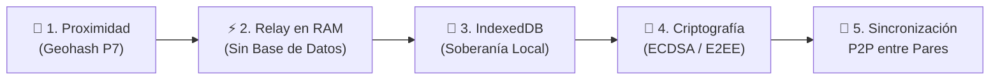

# 📱 ZonaViva — Resumen Ejecutivo y Guía Rápida de la Plataforma
## Red Social Geográfica, Descentralizada y Soberana
### Proyecto de Lenguajes de Programación — Unidad 2 (Puno, Perú)

---

## ⚡ Ficha Técnica del Proyecto

| Parámetro | Definición |
| :--- | :--- |
| **Nombre** | **ZonaViva (v3.1 MVP)** |
| **Tipo de Aplicación** | Aplicación Web Progresiva (**PWA**) instalable y operable offline |
| **Enfoque Arquitectónico** | *Client-Heavy* · Servidor Relay Efímero Cero-Persistencia · Sincronización P2P |
| **Zona Piloto** | Ciudad de Puno, Perú (6 Zonas Oficiales OpenStreetMap) |
| **Seguridad Criptográfica** | Sellado Canónico ECDSA P-256 · Cifrado E2EE (ECDH P-256 + AES-GCM-256) · Código SAS |
| **Persistencia** | Descentralizada y Soberana en el Navegador (`IndexedDB` vía Dexie.js) |
| **Calidad de Software** | ✅ 117 Pruebas Unitarias/Integradas Pasando (100%) · TypeScript Estricto |

---

## 🎯 ¿Qué es ZonaViva y qué Problema Resuelve?

Las redes sociales comerciales (Meta, X, TikTok) padecen de tres graves deficiencias:
1. **Extracción y Monopolio de Datos:** Almacenan historiales, teléfonos y perfiles de los ciudadanos en servidores centrales para comerciar con su atención.
2. **Desconexión Comunitaria:** Priorizan algoritmos de indignación global por encima de la realidad comunitaria inmediata (tráfico local, ferias vecinales, avisos cívicos).
3. **Puntos Centrales de Censura y Falla:** Una caída del servidor o una orden arbitraria apaga la comunicación ciudadana.

**ZonaViva** devuelve la conversación digital a su contexto físico territorial mediante tres pilares éticos:
- **Proximidad Física:** Para publicar en un foro comunitario permanente, debes estar físicamente en el lugar. La lectura a distancia permanece abierta para informarse.
- **Privacidad por Diseño:** Las coordenadas GPS jamás salen del dispositivo; el servidor solo recibe identificadores de zona o Geohashes locales. Sin correos, sin contraseñas ni números telefónicos.
- **Soberanía del Dato:** El servidor Relay corre puramente en memoria RAM (0 bytes en disco). Los mensajes viven exclusivamente en los teléfonos de los vecinos y se transfieren entre ellos vía sincronización P2P.

```
┌────────────────────────────────────────────────────────────────────────┐
│                        ZONAVIVA vs. REDES COMERCIALES                  │
├────────────────────────┬──────────────────────────┬────────────────────┤
│ Característica         │ Red Social Tradicional   │ ZonaViva           │
├────────────────────────┼──────────────────────────┼────────────────────┤
│ Base de Datos Central  │ Servidor SQL/NoSQL nube  │ ❌ NINGUNA (0 BD)  │
│ Dónde viven tus datos  │ Servidores de la empresa │ 📱 En tu teléfono  │
│ Privacidad de tu GPS   │ Rastreo y registro 24/7  │ 🔒 Cómputo local   │
│ Registro de cuenta     │ Correo, teléfono, pass   │ 🎲 Alias + Llave   │
│ Conexión requerida     │ 100% online permanente   │ ⚡ PWA + Outbox     │
│ Mensajes Privados      │ Custodiados en servidor  │ 🔒 E2EE con SAS    │
└────────────────────────┴──────────────────────────┴────────────────────┘
```

---

## 🏛️ Los 5 Pilares de la Arquitectura



1. **Proximidad Geográfica y Geocercado Local:**
   - La ciudad se discretiza en celdas **Geohash Precisión 7** (~153m x 153m).
   - El cliente evalúa sus coordenadas GPS frente al catálogo de zonas en $O(1)$ sin enviar latitud ni longitud a la red.
2. **Servidor Relay Cero-Persistencia:**
   - Nodo liviano en Node.js + Socket.IO.
   - Enruta mensajes en tiempo real y asigna la hora oficial monotónica (`relayTs`), pero **no posee base de datos ni escribe en disco**.
3. **Soberanía Local en `IndexedDB` (Dexie.js):**
   - El historial de mensajes se guarda directamente en la base de datos local del navegador.
   - Cuenta con cola de salida (`outbox`) para redactar mensajes sin conexión y despacharlos al reconectar.
4. **Criptografía Nativa y Sellado Canónico:**
   - **Sellado Canónico:** Cada mensaje público es sellado por el relay con firma digital ECDSA P-256; los clientes verifican la firma antes de guardarlo, impidiendo inyecciones maliciosas.
   - **Cifrado E2EE:** Los chats 1 a 1 utilizan curvas elípticas (ECDH P-256), derivación de claves HKDF y cifrado simétrico autenticado AES-GCM-256. Ambas partes comparan un **Código SAS de 6 dígitos** para certificar ausencia de espionaje.
5. **Sincronización P2P Asistida:**
   - Cuando un usuario recién llegado abre un foro, el relay pide una copia a otros vecinos conectados en la sala, quienes le retransmiten los mensajes sellados de forma distribuida.

---

## 🗺️ Zonas Piloto en Puno (Topología Oficial OSM)

ZonaViva incluye 6 nodos cívicos y comerciales de Puno extraídos de OpenStreetMap:

| Zona Oficial | Color | Celdas P7 | Radio Aprox. | Relevancia Urbana |
| :--- | :---: | :---: | :---: | :--- |
| **Plaza Mayor de Puno** | 🟣 Violeta | 4 celdas | ~150m | Núcleo histórico, cívico y turístico de la ciudad. |
| **Parque Pino** | 🟢 Esmeralda | 4 celdas | ~150m | Espacio cultural frente al Templo San Juan y Colegio San Carlos. |
| **Mercado Central** | 🟠 Naranja | 4 celdas | ~200m | Centro neurálgico de comercio tradicional y abastecimiento. |
| **Mercado Unión y Dignidad** | 🌸 Rosa | 6 celdas | ~200m | Mayor polo comercial y de ferias de Puno (zona terminal). |
| **Mercado Bellavista** | 🟡 Amarillo | 6 celdas | ~200m | Sector comercial y ferias dominicales cerca al lago. |
| **Campus UNAP** | 🔵 Azul | 26 celdas | Polígono completo | Ciudad universitaria de la Universidad Nacional del Altiplano. |

> **Garantías Matemáticas:** Las 50 celdas activas cumplen formalmente **Cero Solapamiento** (conjuntos disjuntos) y **Cero Islas** (100% de conexidad continua validada con algoritmo BFS Flood-Fill).

---

## 📲 Catálogo Rápido de Pantallas (UI/UX Móvil-Primero)

La interfaz se estructura sobre una barra táctil inferior ergonómica de 4 secciones:

```
┌────────────────────────────────────────────────────────┐
│ [🗺️ Inicio]    [💬 Foros]    [✨ Chat]    [⚙️ Ajustes] │
└────────────────────────────────────────────────────────┘
```

### 1. 🗺️ Inicio (`/`) — Mapa Interactivo y Radar GPS
- **Mapa en Vivo:** Representación cartográfica interactiva de Puno con las 6 zonas coloreadas y radar de posición.
- **Detección Automática:** Si estás físicamente en una zona, la tarjeta resalta en verde: `"Estás aquí (publicación habilitada)"`.
- **Modo Exploración:** Si tocas otra zona en el mapa, puedes explorarla libremente en modo solo lectura.

### 2. 💬 Foros (`/foros` y `/foro/:id`) — Espacios Públicos de Diálogo
- **Tres Pestañas:**
  - *Zonas Oficiales:* Foros permanentes de las 6 zonas de Puno con conteo de usuarios en vivo.
  - *Cerca de mí:* Foros temporales creados por vecinos en un radio de proximidad.
  - *Mis Foros:* Foros guardados con insignias de mensajes no leídos.
- **Regla de Publicación:** Para escribir en un foro permanente debes estar físicamente en la zona (o tener activado el selector de simulación GPS en desarrollo). Explorar remotamente permite leer, pero bloquea el envío.
- **Foros Temporales de Usuario (`/foros/nuevo`):** Cualquier ciudadano presente puede fundar un foro efímero (50m a 1000m de radio). Si pasa 24 horas consecutivas sin participantes activos, el foro caduca automáticamente.

### 3. ✨ Chat (`/chat`) — Comunicación Privada y Cifrada E2EE
- **Chat Aleatorio 1:1:** Permite buscar un interlocutor al azar para conversar de forma efímera.
  - *Selector de Ámbito:* Las **Zonas Permanentes** están siempre abiertas para iniciar búsquedas desde cualquier punto. Los **Foros Temporales** requieren presencia o suscripción.
  - *Alertas Selectivas:* Cuando alguien busca conversación, la alerta visual (*"Hay vecinos esperando..."*) y el badge pulsante solo se notifican a usuarios presentes o suscritos a esa zona, evitando molestar a vecinos alejados.
  - *Código SAS:* Muestra un código de 6 dígitos (ej. `492 108`) para validar la seguridad del canal.
- **Contactos y Mensajes Directos:** Posibilidad de enviar solicitudes de amistad a los autores de mensajes en los foros y sostener chats privados cifrados permanentes.

### 4. ⚙️ Ajustes (`/ajustes`) — Soberanía y Privacidad
- **Alias y Credenciales:** Cambio de alias y botón de *"Renovar Identidad"* (destruye las claves criptográficas y genera un nuevo par).
- **Control de Datos:** Métrica de megabytes e historial almacenado en el navegador, solicitud de almacenamiento persistente (`navigator.storage.persist()`) y botón para purgar absolutamente todos los datos locales.

---

## 💡 Justificación de Decisiones Técnicas Clave

| Decisión Técnica | Alternativa Descartada | Justificación Estratégica |
| :--- | :--- | :--- |
| **PWA (Web Progresiva)** | App Nativa (Android/iOS) | Cero barrera de descarga (QR inmediato en la calle), multiplataforma, inmune a censura de tiendas, soporte offline con Service Workers. |
| **React 18 + Vite (SPA)** | SSR (Next.js / Remix) | Arquitectura *client-heavy*: el GPS, WebCrypto y Dexie corren en el procesador del usuario. SSR filtraría metadatos y sumaría costos de servidor innecesarios. |
| **Zustand (1.1 KB)** | Redux / Context API | Selectores atómicos que evitan re-renderizar el mapa Leaflet con cada oscilación del GPS. Acceso imperativo desde eventos de sockets y sincronización fuera de React. |
| **Leaflet + OpenStreetMap** | Google Maps / Mapbox | Gratuito, sin tarjetas de crédito ni cuotas, ético, sin cookies de seguimiento y con caché offline de mapas por 30 días mediante Workbox (`CacheFirst`). |
| **IndexedDB (Dexie.js)** | LocalStorage / WebSQL | Permite almacenar megabytes/gigabytes de historial sin congelar la UI (asíncrono) y admite consultas de rango `[forumId+relayTs]` para sincronización P2P. |
| **Bottom Nav + Dark Theme** | Menú hamburguesa superior / Tema claro | Ergonomía para una sola mano (zona del pulgar) y alto contraste para legibilidad bajo el sol intenso y altitud de Puno (3,812 m.s.n.m.), ahorrando batería OLED. |
| **Onboarding Passwordless** | Formulario con email y pass | Cero fricción: alias aleatorio + llaves ECDSA generadas en <500ms. Listo para chatear en 5 segundos sin recopilar ningún dato personal (Zero-PII). |

---

## 🧪 Calidad y Validación de Software

- **117 Pruebas Unitarias e Integradas:** Ejecutadas con **Vitest** cubriendo criptografía E2EE, protocolo Zod, cálculo de Geohash/Haversine, políticas de acceso geográfico, base de datos IndexedDB y chats directos. **100% de éxito (0 fallos)**.
- **Tipado Estricto TypeScript:** Monorepo verificado con `tsc --noEmit` sin emisiones ni uso de tipos genéricos inseguros (`any`).
- **Validación en Tiempo de Ejecución:** Esquemas tipados con **Zod** para todo payload entrante y saliente por WebSockets.

---

## 🚀 Puesta en Marcha Rápida (3 Pasos)

### 1. Clonar e Instalar
```bash
git clone <repositorio>
cd "plataforma red social"
pnpm install
```

### 2. Iniciar Servicios en Desarrollo
Abrir dos terminales:
```bash
# Terminal 1: Servidor Relay (Puerto 3001)
pnpm dev:relay

# Terminal 2: Aplicación Web PWA (Puerto 5173)
pnpm dev:web
```
*Abrir navegador en:* `http://localhost:5173`

### 3. Pruebas de Campo en Celulares con GPS Real (Túnel HTTPS)
Los navegadores móviles requieren HTTPS (*Secure Context*) para permitir el acceso al GPS. Para probar en un teléfono real sin certificados complejos:
```bash
# Terminal 3: Exponer mediante túnel seguro Cloudflare
npx cloudflared tunnel --url http://localhost:5173
```
*Abre la URL `https://*.trycloudflare.com` en tu celular: el navegador solicitará permiso GPS de inmediato y conectará con el Relay.*

---

*Documento ejecutivo de consulta rápida — Proyecto ZonaViva (Lenguajes de Programación, 2026).*
